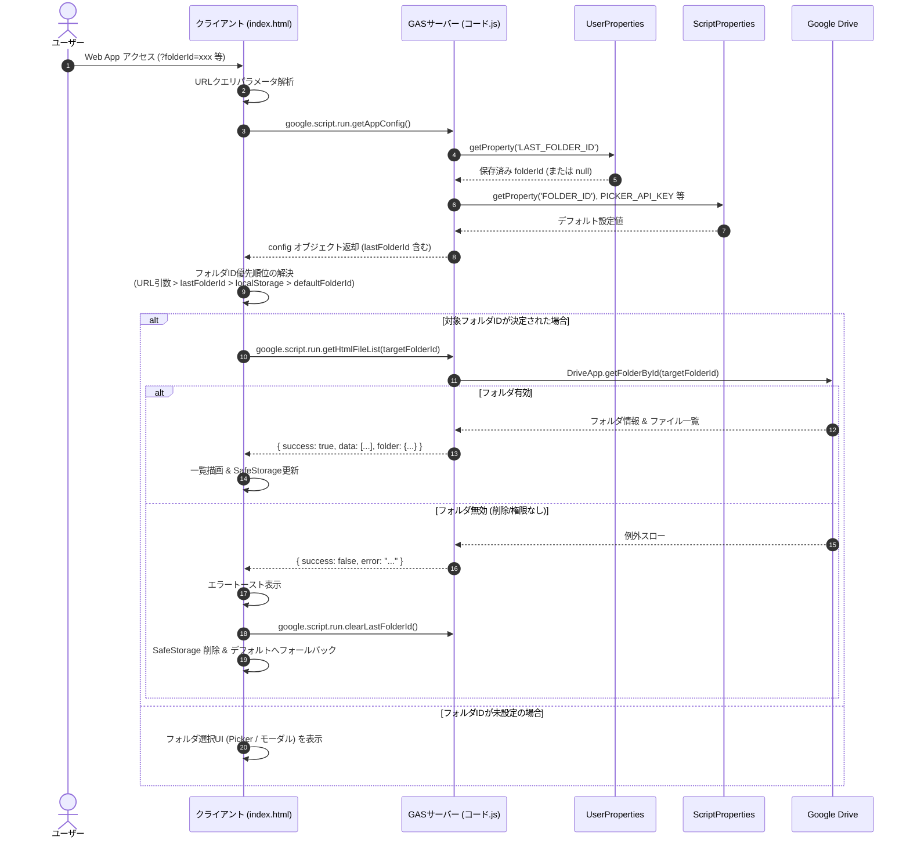
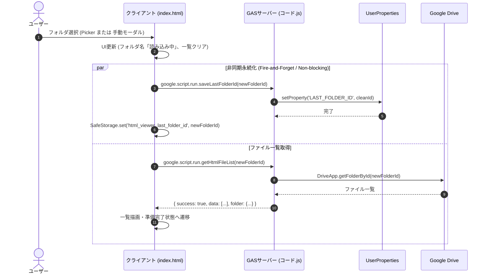

# システムアーキテクチャ設計書

## 1. 要件定義サマリー

### 機能要件 (Functional Requirements)
- **FR-1: 前回選択フォルダの確実な永続化**
  - ユーザーが Google Picker または手動入力モーダルでフォルダを変更した際、選択されたフォルダIDを Google アカウント単位でサーバー側（`PropertiesService.getUserProperties()`）およびクライアント側（利用可能な場合の `localStorage`）に自動保存すること。
- **FR-2: 起動時の自動復元と多層フォールバック**
  - アプリケーション起動時、以下の優先順位（カスケード）に従って対象フォルダIDを自動解決し、該当フォルダ内のHTMLファイル一覧を表示すること。
    1. **URLクエリパラメータ**: `folderId` または `f`（ディープリンク最優先）
    2. **サーバー側ユーザープロパティ**: `PropertiesService.getUserProperties()`（アカウント同期・クロスデバイス最優先）
    3. **クライアント側ローカルストレージ**: `localStorage`（フォールバック）
    4. **スクリプト共通デフォルト**: スクリプトプロパティ `FOLDER_ID` または定数 `DEFAULT_FOLDER_ID`
- **FR-3: 無効化フォルダの自己修復・自動リカバリー**
  - 永続化されていたフォルダが削除、ゴミ箱への移動、アクセス権限の喪失等によりアクセス不可となった場合、エラーを適切にハンドリングし、無効な保存データを自動消去（クリーンアップ）した上で、デフォルトフォルダへの切り替えまたはフォルダ選択画面の提示を安全に行うこと。
- **FR-4: URLパラメータによるディープリンク制御**
  - Web App URL に `?folderId=<ID>` または `?f=<ID>` が指定された場合、保存された前回設定を上書きして指定フォルダを優先表示すること。
- **FR-5: バックエンド API の整備**
  - 初期化設定取得 API（`getAppConfig`）において前回フォルダIDを統合返却し、さらにフォルダ保存用 API（`saveLastFolderId`）およびクリア用 API（`clearLastFolderId`）を提供すること。

### 非機能要件 (Non-Functional Requirements)
- **NFR-1: ストレージパーティショニング・サードパーティCookie制限下での信頼性**
  - Google Apps Script のサンドボックス iframe 環境（`script.googleusercontent.com`）において、Chrome CHIPS、Safari ITP、Firefox ETP、シークレットモード等によりクライアント側ストレージがブロックまたは初期化される環境でも、サーバー側 `UserProperties` により 100% 確実に永続化・復元が行えること。
- **NFR-2: 例外遮断（Graceful Degradation）**
  - ブラウザのセキュリティ設定により `localStorage` アクセス時に `SecurityError` 等の例外が発生した場合でも、エラーを完全に捕捉して動作を継続し、Web アプリケーション全体がクラッシュ（ホワイトアウト）しないこと。
- **NFR-3: 低レイテンシ・UXの維持**
  - 起動時の初期化通信（RPC）は `getAppConfig()` の 1 往復（1 RTT）で設定および前回フォルダ情報を取得可能とし、無駄な連続リクエスト（ウォーターフォール）を排除すること。
  - フォルダ変更時の永続化保存は非同期・非ブロッキングで実行され、一覧取得やファイルプレビューのユーザー操作を妨げないこと。
- **NFR-4: クロスデバイス・マルチブラウザ同期**
  - 同一の Google アカウントであれば、PC、タブレット、スマートフォン、別ブラウザ間でも前回開いたフォルダが引き継がれること。
- **NFR-5: セキュリティと権限の厳格な分離**
  - ユーザープロパティは Google アカウントごとに安全に分離管理され、他ユーザーのフォルダ設定との干渉や情報漏洩が発生しないこと。また、受け取るフォルダIDは厳格にバリデーション（サニタイズ）されること。

### 前提条件と制約事項
- **実行基盤**: Google Apps Script (V8 ランタイム) Web App。
- **デプロイ設定**: `executeAs: USER_DEPLOYING`, `access: MYSELF`（または `USER_ACCESSING`）。いずれの場合も `PropertiesService.getUserProperties()` は実行/アクセスユーザー単位のストレージとして機能する。
- **iframe 環境制約**: GAS の Web App は親ドメイン（`script.google.com`）内のサンドボックス iframe ドメイン（`script.googleusercontent.com`）で稼働するため、クライアントサイドストレージの信頼性が本質的に低い。
- **ストレージ容量制約**: `PropertiesService.getUserProperties()` は 1 プロパティあたり最大 9KB、全体で 500KB。フォルダID（約 33〜44 文字）の永続化には十分な容量である。

### 不明点・ブロッキング事項
- 現状なし（原因、仕様制約、解決策ともに特定・検証済み）。

---

## 2. システム境界とコンポーネント構成

### システム境界図
```
+-----------------------------------------------------------------------------------+
| ブラウザ環境 (Client Side - index.html)                                            |
|                                                                                   |
|  +--------------------+        +---------------------+      +------------------+  |
|  |  UI / Presentation | <----> | AppStateController  | <--> |  FolderResolver  |  |
|  |  (DOM, Event)      |        | (Folder / File / UI)|      |  (Cascade Logic) |  |
|  +--------------------+        +---------------------+      +------------------+  |
|                                           |                           |           |
|                                           v                           v           |
|                                +---------------------+      +------------------+  |
|                                | SafeStorage Adapter |      | URL Param Parser |  |
|                                | (try-catch Wrapper) |      | (?folderId=...)  |  |
|                                +---------------------+      +------------------+  |
|                                           |                                       |
|                                           v                                       |
|                                     localStorage                                  |
|                                  (Best-effort Only)                               |
+-------------------------------------------|---------------------------------------+
                                            | google.script.run (RPC)
+-------------------------------------------v---------------------------------------+
| Google Apps Script 実行基盤 (Server Side - コード.js)                               |
|                                                                                   |
|  +-----------------------------------------------------------------------------+  |
|  | Request Handler & API Layer                                                 |  |
|  | - doGet(e): URLパラメータ解析とテンプレート生成                             |  |
|  | - getAppConfig(): アプリ設定 + 保存フォルダID返却                           |  |
|  | - saveLastFolderId(folderId): フォルダID検証 & ユーザープロパティ保存        |  |
|  | - clearLastFolderId(): ユーザープロパティ削除                               |  |
|  | - getHtmlFileList(folderId) / searchHtmlFiles(...)                            |  |
|  +-----------------------------------------------------------------------------+  |
|                      |                                       |                    |
|                      v                                       v                    |
|         +-------------------------+             +-------------------------+       |
|         |    PropertiesService    |             |        DriveApp         |       |
|         | - getUserProperties()   |             | - getFolderById()       |       |
|         | - getScriptProperties() |             | - HTML File Search      |       |
|         +-------------------------+             +-------------------------+       |
+-----------------------------------------------------------------------------------+
```

### 各コンポーネントの責務
1. **クライアントサイド (`index.html`)**
   - **`SafeStorage` (ストレージアダプター)**:
     - `window.localStorage` へのアクセスを `try-catch` で安全にカプセル化し、ストレージアクセス禁止例外（`SecurityError`）発生時でもアプリのクラッシュを防止する。
   - **`FolderResolver` (フォルダ優先順位解決コンポーネント)**:
     - URLパラメータ、サーバーから受信した `UserProperties`、`SafeStorage`、スクリプトデフォルト値の 4 層から、開くべきフォルダIDを厳格なカスケード順で決定する。
   - **`AppStateController` (状態管理・データ連携コントローラー)**:
     - フォルダ変更イベントを検知し、一覧取得リクエストと並行して非同期で永続化保存（サーバー側 `saveLastFolderId` + クライアント側 `SafeStorage`）を発行する。
     - フォルダアクセスエラー発生時にリカバリー処理（プロパティ消去とフォールバック）を調停する。
   - **`UI / Presentation`**:
     - フォルダ名、ファイル一覧、プレビュー画面、エラー通知トースト等のレンダリングを担当する。

2. **サーバーサイド (`コード.js`)**
   - **`Config & Session Gateway` (`getAppConfig`, `doGet`)**:
     - `doGet(e)` で受け取ったクエリパラメータをテンプレートに受け渡す、または `getAppConfig` 内でクライアント初期化用設定と保存済みフォルダID（`UserProperties` 由来）を束ねて返却する。
   - **`UserPreferenceManager` (`saveLastFolderId`, `clearLastFolderId`)**:
     - フォルダIDのフォーマット・アクセス検証を行い、`PropertiesService.getUserProperties()` への安全な保存および削除を担う。
   - **`DriveContentProvider` (`getFolderDetails`, `getHtmlFileList`, `getHtmlFileContent`)**:
     - 指定フォルダの存在確認、権限確認、HTMLファイルのフィルタリング・メタデータ抽出・コンテンツ取得を行う。

### 外部依存関係
- **Google Apps Script `PropertiesService`**: ユーザー単位およびスクリプト単位のデータ永続化。
- **Google Apps Script `DriveApp`**: ドライブおよびフォルダ・ファイルの走査・取得。
- **Google Picker API**: ドライブフォルダ選択ダイアログの提供。
- **Tailwind CSS**: レスポンシブ UI スタイリング。

---

## 3. データフローとインターフェース

### 3.1 アプリケーション初期化・前回フォルダ復元フロー


### 3.2 フォルダ切り替え・永続化フロー


### 3.3 主要インターフェース定義

#### サーバーサイド（Google Apps Script）
```typescript
/**
 * アプリ設定およびユーザー固有の前回設定を返却
 */
function getAppConfig(): {
  token: string;
  apiKey: string;
  projectNumber: string;
  defaultFolderId: string;
  lastFolderId: string; // 新規追加: UserPropertiesから取得した前回フォルダID
  urlFolderId?: string; // オプション: doGetから引き渡されたURLパラメータ
};

/**
 * ユーザーの前回選択フォルダIDをUserPropertiesに保存する
 * @param folderId - 保存対象のフォルダID（ドライブURL可、サニタイズ処理を実施）
 */
function saveLastFolderId(folderId: string): {
  success: boolean;
  savedFolderId?: string;
  error?: string;
};

/**
 * ユーザーの前回選択フォルダIDをUserPropertiesから削除する（自己修復・クリア用）
 */
function clearLastFolderId(): {
  success: boolean;
  error?: string;
};
```

#### クライアントサイド（JavaScript）
```typescript
/**
 * セキュアストレージラッパー
 */
interface SafeStorageAdapter {
  get(key: string): string | null;
  set(key: string, value: string): boolean;
  remove(key: string): boolean;
}

/**
 * フォルダIDカスケード解決ロジック
 */
interface FolderResolutionResult {
  folderId: string | null;
  source: 'URL' | 'USER_PROPERTIES' | 'LOCAL_STORAGE' | 'DEFAULT' | 'NONE';
}

function resolveInitialFolderId(
  urlParamId: string | null,
  userPropId: string | null,
  localStorageId: string | null,
  defaultPropId: string | null
): FolderResolutionResult;
```

---

## 4. アーキテクチャ上の決定事項 (ADR)

### ADR-1: サーバーサイド永続化（`PropertiesService.getUserProperties()`）の主ストレージ採用
- **決定**:
  - 前回選択フォルダIDのプライマリストレージとして、Google Apps Script 標準の `PropertiesService.getUserProperties()` を採用する。
- **理由**:
  - Google Apps Script の Web アプリケーションはサンドボックス化された iframe（`script.googleusercontent.com`）内で動作する。現代のWebブラウザ（Chrome, Safari, Firefox）ではサードパーティCookieの規制強化、ストレージパーティショニング（CHIPS）、プライベートブラウジングモード等により、iframe 内の `localStorage` が遮断されるか、一時的な揮発メモリとして扱われ、ブラウザ再起動で消失する。
  - `PropertiesService.getUserProperties()` は Google アカウントに紐づいてサーバー側で確実に永続化されるため、ブラウザのセキュリティ設定・制約に一切左右されない。
- **検討した代替案**:
  - *代替案A: `localStorage` のみ（現状維持）*: iframeストレージ制約により再開失敗が頻発し、要件を満たせない。
  - *代替案B: Google ドライブ上に設定ファイル（JSON等）を生成・保存*: 権限スコープの拡大（書き込み権限）、ドライブ上のゴミファイル増加、ファイルI/Oレイテンシの観点から不採用。
  - *代替案C: `PropertiesService.getScriptProperties()`*: アプリ全体で共有されるため、複数ユーザーが利用した場合にフォルダ選択が競合・上書きされる。
- **トレードオフ**:
  - サーバーとの RPC 通信が必要となるが、既存の初期化通信 `getAppConfig()` のレスポンスに統合することで、追加のネットワークラウンドトリップをゼロ（0 RTT 増加）に抑えられる。
- **結果・影響**:
  - ブラウザ環境に依存しない 100% 確実な再開が実現する。PC とスマートフォン間でのシームレスなフォルダ状態同期が可能となる。

---

### ADR-2: 多層防御型フォールバックチェーン（URL > UserProperties > localStorage > Default）の採用
- **決定**:
  - 対象フォルダの決定において、明確な優先順位カスケードを適用する。
  - 優先順位:
    1. URL クエリパラメータ (`?folderId=...` または `?f=...`)
    2. サーバーサイド `UserProperties`
    3. クライアントサイド `localStorage` (セーフガード付き)
    4. スクリプトプロパティ `FOLDER_ID`（デフォルト）
- **理由**:
  - ディープリンク共有、アカウント跨ぎ同期、オフラインや通信遅延時の保険、初期セットアップ時の案内というすべてのユースケースを整合性を保ちながら満たすため。
- **検討した代替案**:
  - *代替案A: UserProperties のみを参照*: URL パラメータによる直接共有や、クライアントキャッシュの即時反映性が失われる。
- **トレードオフ**:
  - クライアント初期化ロジックにカスケード評価ステップが必要となるが、コード行数の増加は僅かであり、システムの堅牢性が大幅に向上する。
- **結果・影響**:
  - ユーザーが特定フォルダへのブックマークやリンク共有を利用できる柔軟性を獲得しつつ、通常アクセス時は直前の作業フォルダから確実に再開できる。

---

### ADR-3: クライアントストレージの防御的カプセル化（`SafeStorage`）
- **決定**:
  - クライアント側での `window.localStorage` に対するすべての読み書き・削除操作を `try-catch` で保護したラッパー経由で実行する。
- **理由**:
  - 厳しいセキュリティポリシーが設定されたブラウザや組織管理端末、シークレットモード下では、`localStorage.getItem` や `localStorage.setItem` を呼び出した瞬間に `DOMException: SecurityError` がスローされ、JSの実行が停止するリスクがある。
- **検討した代替案**:
  - *代替案A: `localStorage` を完全に廃止*: サーバーとの通信が一時的に不安定になった場合やローカル完結の高速キャッシュとしての利点を捨てることになる。
- **トレードオフ**:
  - ラッパー関数の実装が必要（オーバーヘッドは無視できるレベル）。
- **結果・影響**:
  - どのようなブラウザ制約下でも JavaScript エラーによる画面停止（ホワイトアウト）が絶対に発生しない。

---

### ADR-4: フォルダ変更時の楽観的UI更新と非同期・非ブロッキング永続化
- **決定**:
  - ユーザーがフォルダを変更した際、サーバー側永続化 API（`saveLastFolderId`）のレスポンスを待たずに即座にファイル一覧取得リクエストと UI 表示更新を開始する。
- **理由**:
  - ユーザー体験（レスポンス性）の最大化。保存完了を直列で待つと、フォルダ切り替えの待機時間が約 2 倍に増加してしまう。
- **検討した代替案**:
  - *代替案A: 保存完了を待ってから一覧を取得する（直列同期）*: ネットワーク遅延の影響を直接受け、UIが重く感じられる。
- **トレードオフ**:
  - 万が一サーバーへの保存が通信エラーで失敗した場合でも画面上の閲覧は継続される。この場合、コンソールログや警告トーストで緩やかに通知し、閲覧操作自体はブロックしない。
- **結果・影響**:
  - ネイティブアプリケーションのような極めて軽快な操作性を維持できる。

---

## 5. 品質特性に関する考慮事項

### セキュリティ (Security)
- **ユーザー隔離**: `PropertiesService.getUserProperties()` は Google アカウントごとに物理的に独立したデータ領域に格納されるため、他ユーザーのフォルダ設定が混ざる危険性はない。
- **IDバリデーション**: `saveLastFolderId` で受け取ったフォルダIDは、既存の `sanitizeFolderId_` を通過させ、Google ドライブの有効なID形式（英数字、ハイフン、アンダースコア）のみを許可する。不正なスクリプト文字列や改行等の混入を遮断する。

### スケーラビリティ & パフォーマンス (Scalability & Performance)
- **RPC 通信オーバーヘッドの最小化**: アプリ起動時に「設定取得」と「前回フォルダ取得」を個別に行わず、`getAppConfig()` 内で同時に返却することで、GAS の通信クォータ消費とレイテンシを抑制する。
- **クォータ配慮**: フォルダIDという極小の文字列（数十バイト）のみを保存するため、プロパティサービスの容量上限（500KB）に対する影響はほぼ皆無である。

### 信頼性 & 可用性 (Reliability & Availability)
- **自己修復機構 (Self-Healing)**: 保存されたフォルダが削除されたり、ゴミ箱に移動されたり、アクセス権が剥奪された場合、`getHtmlFileList` の失敗検知時に即座に `clearLastFolderId()` を呼び出して無効な状態を破棄し、デフォルトフォルダまたはフォルダ選択モーダルへ自動フォールバックする。デッドロック（永遠に開けないエラー状態）に陥ることを防ぐ。
- **Graceful Degradation**: `localStorage` が無効化されている環境でも `UserProperties` 側で 100% カバーされ、逆にオフライン等でサーバー通信が遅延した場合はローカルストレージが補助する相互補完アーキテクチャを実現する。

### 保守性 (Maintainability)
- **単一責任の原則 (SRP)**:
  - サーバー側: 設定・プロパティ管理、コンテンツ取得、HTMLサーブの責務が明確に分離される。
  - クライアント側: ストレージ操作、優先順位判定、UI制御が分離され、今後の機能拡張（例: 表示ソート順やプレビューモードの永続化など）に対しても同一の設計パターンで容易に拡張できる。

---

## 6. 受け入れ基準 (Acceptance Criteria)

### 正常系
- [ ] **AC-1 (サーバーサイド永続化)**: フォルダを選択（Picker または 手動モーダル）した際、`PropertiesService.getUserProperties()` の `LAST_FOLDER_ID` に正しいフォルダIDが保存されること。
- [ ] **AC-2 (前回フォルダからの自動再開)**: フォルダ選択後にブラウザタブをリロード、またはブラウザを再起動して Web App を再度開いた際、前回選択したフォルダが自動的にロードされ、ファイル一覧が表示されること。
- [ ] **AC-3 (クロスデバイス同期)**: 同一の Google アカウントで異なるブラウザ（例: Chrome と Edge、または PC とスマートフォン）からアクセスした場合、最後に選択したフォルダが引き継がれて表示されること。
- [ ] **AC-4 (サードパーティストレージ制限下の動作)**: シークレットモード（プライベートブラウジング）や、サードパーティ Cookie / ストレージがブロックされた環境でも、前回選択フォルダの保存・復元がエラーなく動作すること。
- [ ] **AC-5 (URLパラメータの優先)**: Web App の URL に `?folderId=<FOLDER_ID>` を付与してアクセスした場合、前回保存されたフォルダに関わらず、指定されたフォルダが最優先で開かれること。

### 異常系・境界条件
- [ ] **AC-6 (無効フォルダのリカバリー)**: 前回選択したフォルダが Google ドライブ上で削除またはゴミ箱に移動された状態で Web App を起動した場合、エラーメッセージが表示され、無効な保存情報が自動削除された上で、デフォルトフォルダへの切り替えまたはフォルダ選択ダイアログへの誘導が安全に行われること。
- [ ] **AC-7 (例外保護)**: `localStorage` へのアクセス時に例外が発生する環境であっても、JavaScript エラーで画面が停止せず、サーバー側プロパティのみを用いて正常に動作すること。
- [ ] **AC-8 (非同期保存の耐障害性)**: フォルダ保存処理（`saveLastFolderId`）が一時的にタイムアウトまたはエラーになった場合でも、画面上のファイル一覧読み込み・プレビュー表示が妨げられないこと。
