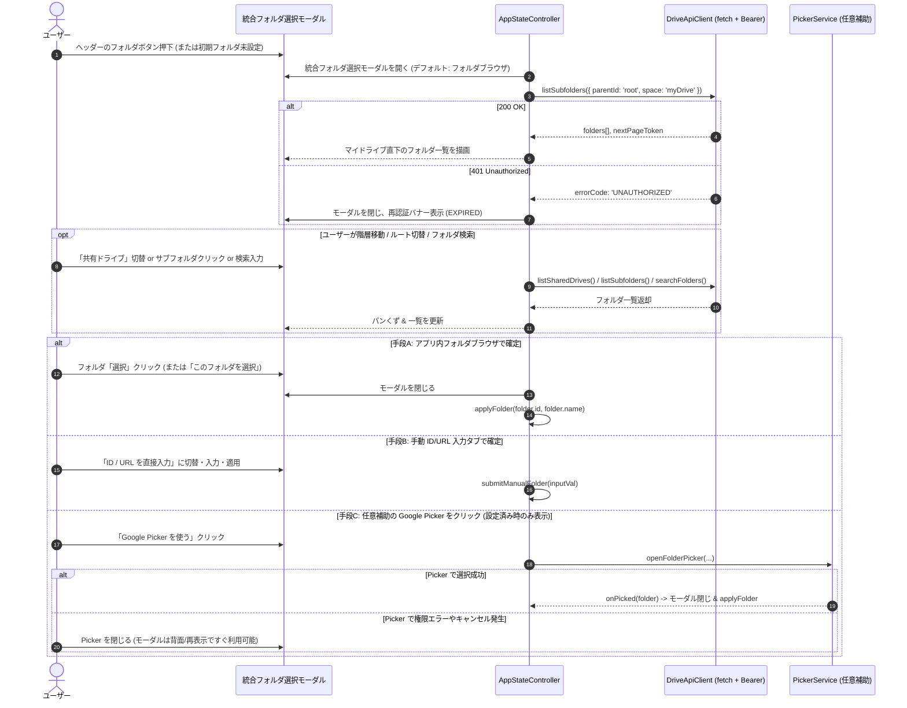

# システムアーキテクチャ設計書（フォルダ選択障害の恒久対策・アプリ内 Drive フォルダブラウザ導入）

> **文書ステータス**: Phase 1（要件定義・システムアーキテクチャ設計） — ユーザー承認ゲート待ち  
> **対象リポジトリ**: `HttpViewer-app`  
> **関連文書**: [ARCHITECTURE_GITHUB_PAGES.md](file:///c:/Users/nanko/Downloads/HttpViewer-app/docs/architecture/ARCHITECTURE_GITHUB_PAGES.md)

---

## 0. 不具合事象の整理と技術的原因分析（事実と推定の区分）

### 0.1 確認済み事実（ユーザー報告および現行コード実体）
- **現象（ユーザー報告）**:
  1. 最初の画面で Google サインイン完了後、フォルダ選択時に Google Picker 側で「権限がない」旨の画面が表示される。
  2. 1 回目のみ「承認」ボタンが表示されて先に進めたが、2 回目以降は同じ画面が出ても承認ボタンが表示されず選択できない。
  3. GCP 接続設定（歯車アイコン）では **OAuth Client ID・Google Picker API Key・Project Number (App ID) をすべて設定済み**である。
- **現行コードベースの事実**:
  - [js/auth.js](file:///c:/Users/nanko/Downloads/HttpViewer-app/js/auth.js): Google Identity Services (GIS) Token Client を用い、最小権限スコープ `https://www.googleapis.com/auth/drive.readonly` でアクセストークンを取得し、メモリ（クロージャ）にのみ保持している。
  - [js/drive-api.js](file:///c:/Users/nanko/Downloads/HttpViewer-app/js/drive-api.js): `fetch` と `Authorization: Bearer <accessToken>` ヘッダにより Google Drive API v3（`https://www.googleapis.com/drive/v3/files`）へ直接通信しており、サードパーティ Cookie に依存せず動作する。
  - [js/picker.js](file:///c:/Users/nanko/Downloads/HttpViewer-app/js/picker.js#L176-L223): `google.picker.PickerBuilder` で `DocsView(FOLDERS)`、`SUPPORT_DRIVES`、`setOAuthToken`、`setDeveloperKey`、`setAppId`、`setOrigin` を設定して `picker.setVisible(true)` を実行しているが、生成した `picker` インスタンスを保持しておらず **`picker.dispose()` による破棄処理を一切行っていない**。
  - [js/app.js](file:///c:/Users/nanko/Downloads/HttpViewer-app/js/app.js#L857-L887): `openFolderSelection()` は `resolvedConfig.isPickerConfigured`（`apiKey` と `appId` が非空）が `true` かつ `pickerService.isLoaded()` が `true` の場合、**Google Picker のみを排他起動**する。`onFallbackToManual` は起動前の設定チェック不足または同期的な JS 例外発生時にのみ呼ばれ、Picker ダイアログ表示後にクロスオリジン `<iframe>` 内で権限エラーが起きても呼び出されない。
  - [index.html](file:///c:/Users/nanko/Downloads/HttpViewer-app/index.html#L47-L60): フォルダ切り替え導線はヘッダーの `#changeFolderBtn` 1 箇所のみであり、Picker が設定されている環境ではユーザーがアプリ内から手動入力モーダル（`#manualFolderModal`）へ到達する手段が完全に失われている。

### 0.2 技術的原因分析（ブラウザ仕様および Google Picker API 仕様に基づく分析）
※以下は実環境のブラウザ開発者ツールログ未取得のため、現行コードとブラウザ / Google Picker API 仕様に基づく技術的推定を含む。

1. **Google Picker `<iframe>` のサードパーティ Cookie / Storage Access API 依存による破綻**:
   - Google Picker はアプリオリジン（GitHub Pages 等）上に `docs.google.com/picker` 等のクロスオリジン `<iframe>` を生成して動作する。
   - アプリは `setOAuthToken(accessToken)` を渡しているものの、Google Picker のウィジェット内部ではセッション検証やアカウント確認のために `google.com` 側のセッション Cookie および **Storage Access API** に依存する挙動がある。
   - モダンブラウザのサードパーティ Cookie 制限（Chrome の 3PC 制限 / シークレットモード、Safari ITP、Firefox ETP 等）下では、クロスオリジン `<iframe>` 内で Cookie が遮断され、「権限がない／Cookie へのアクセス許可が必要」系のエラー画面が表示される。
2. **「1 回目だけ承認ボタンが出て、2 回目以降は出ない」現象のメカニズム**:
   - **要因 A（Storage Access API とユーザージェスチャ／ライフサイクル不整合）**: Storage Access API によるアクセス許可プロンプト（承認ボタン）はブラウザのユーザージェスチャ（クリック直後の同期コンテキスト）やセッション状態に依存する。1 回目は許可操作で通過できても、2 回目以降は「`bootstrapInitialFolder()` 等のサインイン後非同期コールバックから自動起動された」「1 回目の `picker.dispose()` が呼ばれておらず古い Picker `<iframe>` / `gapi` RPC チャネルが DOM に残留し新旧インスタンスが競合した」「ブラウザ側の一時許可状態と Google セッション状態が不一致を起こした」等の要因により、承認 UI が出ないまま権限エラー画面で停止し得る。
   - **要因 B（マルチアカウント不整合）**: ブラウザに複数の Google アカウントでログインしている場合、GIS ポップアップで選択したアカウントの OAuth トークンと、`docs.google.com` `<iframe>` がデフォルトで参照するアカウントセッションが食い違い、Picker 内部で権限エラーとなるケースがある。
3. **アーキテクチャ上の真の根本問題（単一障害点と UI ロックイン）**:
   - クロスオリジン `<iframe>` 内でエラーが発生しても、Google Picker API はホストアプリへ JS 例外やエラーコールバック（`setCallback` へのエラー通知）を返さないブラックボックス仕様である。
   - それにもかかわらず、アプリは **すでにサードパーティ Cookie 非依存の `DriveApiClient` と有効な `drive.readonly` トークンを保持している**にもかかわらず、フォルダ選択だけをサードパーティ Cookie 依存の Google Picker に単一依存（SPOF）させ、代替 UI への導線を遮断している点が構造的な設計欠陥である。

---

## 1. 要件定義サマリー

### 機能要件 (Functional Requirements)
- **FR-1: サードパーティ Cookie 非依存のアプリ内 Drive フォルダブラウザ（一次手段）**
  - ユーザーが Google Picker を経由せず、アプリ自身の DOM 上で Google ドライブ内のフォルダ階層をブラウズして選択できること。
  - **ルート空間の切り替え**: 少なくとも「マイドライブ（`root`）」「共有ドライブ（Shared Drives 一覧）」「共有アイテム（`sharedWithMe`）」の 3 つの起点へ切り替えられること。
  - **階層ナビゲーション**: フォルダ一覧の表示、サブフォルダへの移動（ドリルダウン）、パンくずリストによる上位階層への復帰、および「現在表示中のフォルダを選択」または「一覧内の特定フォルダを直接選択」ができること。
  - **フォルダ名検索**: フォルダ選択ダイアログ内でフォルダ名による検索（Drive API v3 クエリ）が行えること。
  - **ページネーション対応**: 子フォルダ数や共有ドライブ数が多い場合でも、`nextPageToken` により追加読み込みまたは全件取得ができること。
- **FR-2: フォルダ ID / Google Drive URL 直接入力の常時利用可能性（併用手段）**
  - GCP の API Key / App ID 設定有無にかかわらず、ユーザーがフォルダ選択画面からいつでも「フォルダ ID または Google Drive URL 直接入力」に切り替え・実行できること。
- **FR-3: Google Picker の任意補助利用とライフサイクル改善（補助手段）**
  - `apiKey` と `appId` が設定済みかつ `gapi` / `google.picker` が利用可能な場合に限り、フォルダ選択画面からユーザーの明示操作で「Google Picker を開く」を起動できること（失敗時やキャンセル時も選択画面へ安全に戻れること）。
  - Picker インスタンスのライフサイクル管理（前回インスタンスの `dispose()` 実施）を行い、多重生成や RPC 競合を防止すること。
- **FR-4: 既存機能の完全維持**
  - フォルダ確定後の HTML 一覧表示・全文検索・サンドボックス `<iframe>` プレビュー・ディープリンク（`?folderId=` / `?f=`）・`localStorage` 永続化と自己修復・`401` 再認証リカバリー・PC/モバイル 2 ペイン UI・ハイブリッド設定（B-1）をすべて維持すること。

### 非機能要件 (Non-Functional Requirements)
- **NFR-1: ブラウザ互換性とサードパーティ Cookie 非依存性**
  - サードパーティ Cookie がブロックされた環境（Chrome 3PC 制限、シークレットモード、Safari ITP、Firefox ETP）および複数 Google アカウントログイン環境でも、一次フォルダ選択手段が確実に動作すること。
- **NFR-2: 最小権限とゼロトラストの維持**
  - OAuth 2.0 スコープは既存の **`https://www.googleapis.com/auth/drive.readonly`** のみを維持し、`drive.file` や `drive` 等の追加・拡大を行わないこと。
  - アクセストークンは `AuthService` のクロージャメモリ内にのみ保持し、永続ストレージへ保存しないこと。
- **NFR-3: セキュリティ（XSS / インジェクション防御）**
  - フォルダブラウザに表示するフォルダ名・共有ドライブ名はすべて HTML エスケープ（`escapeHtml`）を通し、悪意ある名称による XSS を防止すること。
  - フォルダ検索キーワードおよび親フォルダ ID は、既存の `sanitizeSearchQuery` / `sanitizeFolderId` によりサニタイズすること。
- **NFR-4: 応答性・レースコンディション防止**
  - フォルダ階層の連続クリックや検索入力による非同期レスポンスの順序逆転を防ぐため、リクエスト世代（キャンセルシグナル）管理を行うこと。
- **NFR-5: モバイル対応（レスポンシブ UI）**
  - 幅 768px 未満のモバイル端末でも、フォルダ選択モーダルのスクロール・タップ操作・パンくず表示・タブ切り替えが画面からはみ出さず操作できること。
- **NFR-6: テスト容易性と既存テスト互換性**
  - Node.js 単体・結合テスト（[tests/run_tests.js](file:///c:/Users/nanko/Downloads/HttpViewer-app/tests/run_tests.js) および [tests/adversarial_tests.js](file:///c:/Users/nanko/Downloads/HttpViewer-app/tests/adversarial_tests.js)）のモック環境で動作し、既存のアサーション（`UiAdapter` の `openManualFolderModal` 契約や `index.html` のスクリプト読み込み順序・DOM ID 整合性テスト等）を破壊しないこと。

### 前提条件と制約事項
- **前提条件**:
  - ユーザーは有効な `drive.readonly` アクセストークンを GIS 経由で取得済みであること。
  - Google Cloud Console で **Google Drive API** が有効化されていること（既にファイル一覧取得のため有効化済み）。
- **制約事項**:
  - サーバーサイド処理は追加しない（GitHub Pages 完全静的 SPA 構成の維持）。
  - OAuth スコープ変更不可（`drive.readonly` 固定）。
  - `config.js` と `localStorage` によるハイブリッド設定（B-1）を維持しつつ、Google Picker 用設定（`apiKey` / `appId`）は任意項目として維持する。

### 不明点・確認事項（ブロッキング / 非ブロッキングの区分）
- **ブロッキング事項**: **なし**。
  - 提案アーキテクチャは既存の `drive.readonly` トークンと Drive API v3 のみで自己完結するため、ユーザー環境固有の追加情報（詳細エラーコード等）を待たずに Phase 2（実装計画）へ進むことが可能である。
- **ゲート 1（ユーザー承認時）の確認推奨事項（任意選択）**:
  - **C-1（Google Picker 補助導線の残置要否）**: フォルダ選択モーダル内に「Google Picker で開く（設定済み時）」ボタンを補助導線として残すか、あるいは Picker 自体を UI から廃止し GCP 設定モーダルの項目簡素化まで行うか（本設計書では既存設定との後方互換を重視し「補助導線として残置」を推奨）。

---

## 2. システム境界とコンポーネント構成

### システム境界図

```
+-----------------------------------------------------------------------------------------+
| 静的ホスティング: GitHub Pages (HTML / JS / CSS — サーバーサイド実行なし)               |
+--------------------------------------------|--------------------------------------------+
                                             |
                                             v
+-----------------------------------------------------------------------------------------+
| ブラウザ環境 (Client SPA - ファーストパーティオリジン)                                  |
|                                                                                         |
|  +-----------------------------+      +----------------------------------------------+  |
|  | UI / Presentation           | <--> | AppStateController (js/app.js)               |  |
|  | - 2ペイン / 認証UI          |      | - フォルダ選択統合制御                       |  |
|  | - 統合フォルダ選択モーダル  |      | - 401 再認証誘導 / 自己修復                  |  |
|  |   [1] フォルダブラウザ      |      | - ブラウザ状態（現在階層/パンくず/検索）     |  |
|  |   [2] ID/URL 直接入力       |      +----------------------+-----------------------+  |
|  |   [3] Picker起動(任意補助)  |                             |                          |
|  +-----------------------------+         +-------------------+-------------------+      |
|                                          |                   |                   |      |
|                                          v                   v                   v      |
|                            +------------------+  +--------------------+  +------------+ |
|                            | AuthService      |  | DriveApiClient     |  | PickerSvc  | |
|                            | (js/auth.js)     |  | (js/drive-api.js)  |  | (picker.js)| |
|                            | - Token(メモリ)  |  | - HTML一覧/全文検索|  | - 任意補助 | |
|                            | - drive.readonly |  | - 子フォルダ一覧   |  | - dispose  | |
|                            +--------+---------+  | - 共有ドライブ一覧 |  +-----+------+ |
|                                     |            | - フォルダ検索     |        |        |
|                                     |            +---------+----------+        |        |
+-------------------------------------|----------------------|-------------------|--------+
                                      |                      |                   |
                 GIS (ポップアップ)   |  REST fetch (CORS)   |  iframe (任意)    |
                 Cookie非依存Bearer   |  Bearer Token        |  3PC依存(隔離)    |
                                      v                      v                   v
+-----------------------------------------------------------------------------------------+
| Google Cloud / Google APIs                                                              |
|  - Google Identity Services: accounts.google.com/gsi/client                             |
|  - Google Drive API v3: www.googleapis.com/drive/v3/files , /drive/v3/drives            |
|  - Google Picker API (任意補助のみ): apis.google.com/js/api.js                          |
+-----------------------------------------------------------------------------------------+
```

### 各コンポーネントの責務

1. **`DriveApiClient`（[js/drive-api.js](file:///c:/Users/nanko/Downloads/HttpViewer-app/js/drive-api.js) 拡張）**
   - 既存の HTML ファイル取得・検索・フォルダ詳細検証に加え、フォルダブラウズ用の API 操作を追加する。
   - **子フォルダ一覧取得（`listSubfolders`）**: 指定した親（`'root'`、特定フォルダ ID、共有ドライブ ID、または `'sharedWithMe'` 仮想ルート）配下のフォルダ一覧（`mimeType = 'application/vnd.google-apps.folder' and trashed = false`）を Drive API v3 `files.list` で取得する。
   - **共有ドライブ一覧取得（`listSharedDrives`）**: `GET https://www.googleapis.com/drive/v3/drives` を呼び出し、ユーザーがアクセス可能な共有ドライブ一覧（`id`, `name`）を取得する。
   - **フォルダ名検索（`searchFolders`）**: キーワードによるフォルダ検索（`mimeType = 'application/vnd.google-apps.folder' and trashed = false and name contains '...'`、`supportsAllDrives=true&includeItemsFromAllDrives=true&corpora=allDrives`）を提供する。
   - 全メソッドで既存の `mapDriveHttpError`（`401` / `403` / `404` / `429` / `5xx` 分類）およびキャンセルシグナル（`signal.isCancelled()`）を共通利用する。

2. **`PickerService`（[js/picker.js](file:///c:/Users/nanko/Downloads/HttpViewer-app/js/picker.js) ライフサイクル改善）**
   - 補助機能として Google Picker を起動する際、前回生成した `picker` インスタンスを保持し、新規起動前および `PICKED` / `CANCEL` 時に `picker.dispose()`（メソッド存在確認付き）を呼び出して古い `<iframe>` 残留を防止する。
   - すべての事前条件チェックおよび `onFallbackToManual` 契約は維持する。

3. **`AppStateController`（[js/app.js](file:///c:/Users/nanko/Downloads/HttpViewer-app/js/app.js) 拡張）**
   - `openFolderSelection()` の制御方針を変更し、Google Picker をいきなり全画面排他起動するのではなく、**統合フォルダ選択モーダル（アプリ内フォルダブラウザ＋手動入力＋任意 Picker 導線）**を開く。
   - フォルダブラウザ内の状態（現在の起点タブ、パンくずリスト配列、検索クエリ、非同期リクエスト世代管理、次ページトークン）を管理する。
   - フォルダブラウザ内で `UNAUTHORIZED` (`401`) が返却された場合は、モーダルを閉じて既存の `routeUnauthorizedOrAbort({ type: 'openFolderSelection' })` へ接続し、再認証後にシームレスに復帰させる。
   - **テスト後方互換性**: テスト注入されたモック `ui` が新しいフォルダ選択モーダル API を持たない場合は、既存の `ui.openManualFolderModal(currentFolderId)` へ安全にフォールバックし、既存テスト契約を保護する。

4. **`UI / Presentation`（[index.html](file:///c:/Users/nanko/Downloads/HttpViewer-app/index.html) & `DomUiAdapter` 拡張）**
   - 既存の `#manualFolderModal` を「フォルダを選択」統合モーダルへ拡張（または統合モーダル内にタブ・切替エリアを配置）し、以下を提供する：
     - **アプリ内フォルダブラウザ**: ルート切替（マイドライブ / 共有ドライブ / 共有アイテム）、パンくずリスト、フォルダ名検索入力、フォルダ一覧（`escapeHtml` 適用）、各フォルダの「開く（サブ階層へ移動）」と「このフォルダを選択」、および「現在のフォルダを選択（ルート以外の階層表示時）」操作、「さらに読み込む（次ページ存在時）」。
     - **ID / URL 直接入力**: 既存の `#folderIdInput` と `#submitFolderBtn` を維持（タブ切替または折りたたみ/併設パネルとして提供）。
     - **Google Picker 補助起動ボタン**: `isPickerConfigured && pickerService.isLoaded()` が `true` の場合のみ表示・有効化し、利用不可環境では非表示または補足表示する。

### 外部依存関係
- 新規の外部ライブラリ・CDN・NPM パッケージの追加は**不要**（既存の Vanilla JS + Tailwind CSS CDN + Google Drive API v3 のみで完結）。

---

## 3. データフローとインターフェース

### 3.1 新しいフォルダ選択フロー（シーケンス図）



### 3.2 主要インターフェース定義（概念仕様）

※既存インターフェース（`FolderInfo`, `DriveResult<T>`, `AuthService`, `AppConfig`）との完全な整合性を保つ。

```typescript
/** フォルダブラウズ対象空間 */
type DriveBrowseSpace = 'MY_DRIVE' | 'SHARED_DRIVES' | 'SHARED_WITH_ME' | 'SEARCH';

/** フォルダ一覧アイテム（DriveApiClient 返却型） */
interface DriveFolderItem {
  id: string;
  name: string;
  driveId?: string;       // 共有ドライブ配下の場合のドライブID
  isSharedDrive?: boolean; // drives.list 由来の共有ドライブエントリか
}

/** ページネーション付きフォルダ一覧結果 */
interface FolderBrowsePage {
  items: DriveFolderItem[];
  nextPageToken: string | null;
}

/** DriveApiClient 拡張メソッド */
interface DriveApiClientExtension {
  /**
   * 指定空間・親フォルダ配下のサブフォルダ一覧を取得する (1ページ分)
   */
  listSubfolders(params: {
    space: 'MY_DRIVE' | 'SHARED_DRIVES' | 'SHARED_WITH_ME';
    parentId?: string;     // MY_DRIVE時は 'root' またはフォルダID、SHARED_DRIVES時はドライブIDまたはフォルダID
    driveId?: string;      // corpora='drive' 指定時に使用
    pageToken?: string;
    pageSize?: number;     // 例: 100
  }, signal?: { isCancelled?: () => boolean }): Promise<DriveResult<FolderBrowsePage>>;

  /**
   * ユーザーがアクセス可能な共有ドライブ一覧を取得する
   */
  listSharedDrives(params?: {
    pageToken?: string;
    pageSize?: number;     // Drive API drives.list 上限 100
  }, signal?: { isCancelled?: () => boolean }): Promise<DriveResult<FolderBrowsePage>>;

  /**
   * フォルダ名キーワードでフォルダを検索する（マイドライブ＋共有ドライブ横断）
   */
  searchFolders(params: {
    keyword: string;
    pageToken?: string;
    pageSize?: number;
  }, signal?: { isCancelled?: () => boolean }): Promise<DriveResult<FolderBrowsePage>>;
}
```

#### Drive API v3 リクエストパラメータ方針（公式仕様準拠）
1. **マイドライブ直下 / 任意フォルダ配下**:
   - エンドポイント: `GET https://www.googleapis.com/drive/v3/files`
   - `q`: `'<parentId>' in parents and mimeType = 'application/vnd.google-apps.folder' and trashed = false`
   - `supportsAllDrives=true&includeItemsFromAllDrives=true`
   - `driveId` 指定時（共有ドライブ内ブラウズ時）: `corpora=drive&driveId=<driveId>` を付与（共有ドライブのルート直下は `'<driveId>' in parents` で取得可能）。
   - `orderBy=folder,name`（または `name` 昇順）、`fields=nextPageToken,files(id,name,driveId)`。
2. **共有ドライブ一覧**:
   - エンドポイント: `GET https://www.googleapis.com/drive/v3/drives`
   - `pageSize` 最大 `100`、`fields=nextPageToken,drives(id,name)`。
3. **共有アイテム（他のユーザーから共有されたフォルダ）**:
   - エンドポイント: `GET https://www.googleapis.com/drive/v3/files`
   - `q`: `sharedWithMe = true and mimeType = 'application/vnd.google-apps.folder' and trashed = false`
   - `supportsAllDrives=true&includeItemsFromAllDrives=true`、`fields=nextPageToken,files(id,name,driveId)`。
4. **フォルダ名検索**:
   - エンドポイント: `GET https://www.googleapis.com/drive/v3/files`
   - `q`: `mimeType = 'application/vnd.google-apps.folder' and trashed = false and name contains '<sanitizedKeyword>'`
   - `corpora=allDrives&supportsAllDrives=true&includeItemsFromAllDrives=true`、`fields=nextPageToken,files(id,name,driveId)`。

---

## 4. アーキテクチャ上の決定事項 (ADR)

### ADR-7: フォルダ選択の一次手段を「Drive API v3 ベース・アプリ内フォルダブラウザ」へ移行

- **決定**:
  - フォルダ選択の一次手段（デフォルト動作）として、サードパーティ Cookie に依存しない **Drive API v3 ベースのアプリ内フォルダブラウザ** を採用し、**手動 ID/URL 入力** と統合した「統合フォルダ選択モーダル」を提供する。
  - Google Picker は一次手段から外し、設定済み環境でユーザーが明示的に選択した場合のみ開く **任意の補助手段** へ降格する。
- **理由**:
  - アプリはすでに GIS 経由で有効な `drive.readonly` トークンをメモリ保持しており、Drive API v3 への `Authorization: Bearer` `fetch` 通信はサードパーティ Cookie 制限（3PC ブロック / ITP / ETP / シークレットモード）やマルチアカウント `<iframe>` 不一致の影響を一切受けない。
  - クロスオリジン `<iframe>` で動作する Google Picker はホスト側で権限エラーを検知・自動回復できないブラックボックスであるため、これを一次導線に据える限り同様のブロック・無反応リスクを根絶できない。
  - 副次的なメリットとして、利用者は Google Picker API Key や Project Number を設定しなくても（OAuth Client ID のみで）視覚的なフォルダ選択が可能になる。
- **検討した代替案**:
  - **代替案 B（Google Picker を一次起動のまま維持し、フォールバック導線を併設）**:
    - Picker のパラメータ調整・`dispose()` 実装を行いつつ従来通り最初に Picker を起動し、ユーザーが閉じたり別ボタンでアプリ内ブラウザ／手動入力へ切り替える案。
    - *却下理由*: サードパーティ Cookie ブロック環境や当該障害環境では、フォルダ選択を開くたびに毎回まず「権限がない」エラーダイアログが表示され、ユーザーがそれを閉じて別手段へ切り替え直す操作を強いられるため UX が著しく悪い。
  - **代替案 C（OAuth スコープ変更または `PickerBuilder` パラメータ修正のみ）**:
    - スコープを `drive.file` や `drive` に変更、または `PickerBuilder` のパラメータ調整のみで対処する案。
    - *却下理由*: `drive.readonly` 最小権限維持の制約に反する上、サードパーティ Cookie ブロックによる `docs.google.com/picker` `<iframe>` の制限を突破できない。また手動入力への導線欠如も解消されない。
- **トレードオフ**:
  - **メリット**: サードパーティ Cookie 非依存による高い信頼性、エラーハンドリング（`401` 再認証誘導等）の完全な統一、GCP 設定項目の実質的簡素化、既存テスト基盤での網羅的テスト可能性。
  - **デメリット**: Google Picker 固有の UI（「最近使用したアイテム」表示やサムネイル等）を既定では使用しない点、および `DriveApiClient` / UI にフォルダブラウズ用のコード量が増える点。
- **結果・影響**:
  - `DriveApiClient` に `listSubfolders` / `listSharedDrives` / `searchFolders` が追加され、`AppStateController.openFolderSelection()` の既定挙動が統合フォルダ選択モーダル起動へ変更される。

---

### ADR-8: Google Picker 補助利用時のインスタンス破棄 (`dispose`) 導入と統合モーダル内配置

- **決定**:
  - `PickerService` において生成した Picker インスタンスを保持し、新規起動前および `PICKED` / `CANCEL` コールバック時に `picker.dispose()` を呼び出すよう修正する。
  - 統合フォルダ選択モーダルからユーザーが明示クリックした場合のみ `openFolderPicker` を起動し、起動前に既に統合モーダルが開いている状態（または Picker 失敗・キャンセル時にも統合モーダルが利用可能な状態）を保つ。
- **理由**:
  - 現行コードでは `picker.dispose()` が未実装のため、2 回目以降の起動時に DOM 上に古い Picker `<iframe>` やイベントリスナーが蓄積し、Storage Access や RPC 競合の一因になり得る。
  - また、ユーザー操作（クリックイベント）の同期コンテキストから直接起動し、かつ背後にアプリ内選択手段を残すことで、万一 Picker 側で権限エラーが起きてもユーザーが手詰まりにならない。
- **検討した代替案**:
  - **代替案（Google Picker 機能の完全削除）**: `js/picker.js` および `apiKey` / `appId` 設定を完全に撤去する案。
  - *採用しなかった理由*: 既存のハイブリッド設定（B-1）や `PickerService` 単体テスト、およびサードパーティ Cookie を許可している環境で Google Picker の UI を好む利用者との後方互換性を維持できるため、補助機能として安全に隔離残置する方が影響が少ない（ただしユーザー希望があれば削除も可能として C-1 に明記）。
- **トレードオフ**:
  - `PickerService` のコードとテストを維持するコストは残るが、既存テスト（[tests/run_tests.js](file:///c:/Users/nanko/Downloads/HttpViewer-app/tests/run_tests.js) セクション 7）および設定 UI（`configApiKey` / `configAppId`）との互換性が完全に保たれる。
- **結果・影響**:
  - 既存の `PickerService` の外部シグネチャは破壊せず、内部のインスタンス管理のみ強化する。

---

### ADR-9: `UiAdapter` 契約および既存テストスイートとの後方互換性維持

- **決定**:
  - `AppStateController` がフォルダ選択 UI を開く際、新しい統合モーダルメソッド（例: `openFolderSelectorModal`）を優先呼び出しつつ、テストダブル（モック UI）に当該メソッドが定義されていない場合は既存の `ui.openManualFolderModal(currentFolderId)` へフォールバックする。
  - スクリプトファイル分割を行う場合も、[tests/run_tests.js](file:///c:/Users/nanko/Downloads/HttpViewer-app/tests/run_tests.js) が検証する `index.html` のスクリプト読み込み順序および `getElementById` 整合性を維持する。
- **理由**:
  - 既存の回帰テスト（例: `tests/adversarial_tests.js` の `ADV-REC-002` や `tests/run_tests.js` の `BUG-GP-008`）はモック UI の `openManualFolderModal` が呼ばれることを検証しており、不要な既存テスト破壊を避けつつ新機能を統合できる。
- **検討した代替案**:
  - **代替案（`openManualFolderModal` を廃止して別名メソッドに完全置換）**: 既存テストのモックを全面書き換える必要が生じ、既存テストとの互換性制約に反する。
- **トレードオフ**:
  - `AppStateController` 内に薄い互換分岐が 1 箇所生じるが、既存テストスイートの信頼性をそのまま維持した上で新機能のテストを追加できる利点が上回る。
- **結果・影響**:
  - `tests/run_tests.js` と `tests/adversarial_tests.js` の既存全ケースを維持したまま、フォルダブラウザの正常系・異常系・セキュリティテストを追加可能になる。

---

## 5. 品質特性に関する考慮事項

### セキュリティ (Security)
- **最小権限原則の厳守**: `https://www.googleapis.com/auth/drive.readonly` のみを使用し、書き込み系スコープ（`drive.file`, `drive.appdata`, `drive`）は一切要求しない。
- **トークン保護**: フォルダブラウザ用の API 呼び出しもすべて `authService.getValidToken()` 経由で行い、トークンを DOM や `localStorage` に露出しない。
- **XSS 防御**: Drive API から取得したフォルダ名・共有ドライブ名・パンくず名称は、すべて既存の `escapeHtml()` でサニタイズした上で DOM 描画する（`textContent` またはエスケープ済み文字列のみ使用）。
- **Drive クエリインジェクション防御**:
  - フォルダブラウザでの検索キーワードは `DriveApi.sanitizeSearchQuery()` で制御文字・`\`・`'` を無害化する。
  - `listSubfolders` に渡す `parentId` / `driveId` は `'root'` 以外は `sanitizeFolderId()`（`/^[a-zA-Z0-9_-]+$/`・長さ制限）を必ず通してから `q` クエリ文字列を組み立てる。

### スケーラビリティ & パフォーマンス (Scalability & Performance)
- **オンデマンド遅延読み込み**: アプリ起動時ではなく「フォルダ選択モーダルを開いたタイミング」で初めて `listSubfolders` を実行し、不要な API コールを発生させない。
- **ページネーション制御**: フォルダ階層一覧・共有ドライブ一覧・フォルダ検索は 1 ページあたり `pageSize=100` 程度で取得し、大量のフォルダがある環境でも「さらに読み込む（`nextPageToken`）」によりブラウザメモリと API レイテンシの肥大化を防ぐ。
- **レースコンディション防止**: パンくず連打やフォルダ検索連続入力に対し、リクエスト ID（`signal.isCancelled()`）で古い非同期応答を破棄する。

### 信頼性 & 可用性 (Reliability & Availability)
- **401 トークン期限切れリカバリーとの統合**: フォルダブラウザ操作中に `401 UNAUTHORIZED` が発生した場合、モーダルを閉じて `routeUnauthorizedOrAbort({ type: 'openFolderSelection' })` を実行し、ユーザーがヘッダー／バナーから再認証完了後に自動的にフォルダ選択を再開できる。
- **一時障害時の安全なエラー表示**: `403 rateLimitExceeded` / `429` / `5xx` / 通信エラー時はモーダル内に明確なエラーメッセージと「再試行」手段を提示し、現在表示中のファイル一覧や保存済み `LAST_FOLDER_ID` を誤消去しない。
- **シークレットモード・3PC 完全ブロック耐性**: Google Picker が完全に動作しないブラウザ環境でも、アプリ内フォルダブラウザと手動 ID/URL 入力により 100% 代替運用可能。

### 保守性 (Maintainability)
- **既存モジュール境界の踏襲**: Drive API 通信は `js/drive-api.js`、状態管理は `js/app.js`、Picker 制御は `js/picker.js`、UI は `index.html` と `DomUiAdapter` に明確に分離し、Vanilla JS IIFE + CommonJS デュアルエクスポート規約（Node.js テスト互換）を踏襲する。

---

## 6. 受け入れ基準 (Acceptance Criteria)

### 機能・不具合解消（正常系）
- [ ] **AC-1（サードパーティ Cookie 非依存でのフォルダ選択）**: サードパーティ Cookie をブロックしたブラウザ環境（シークレットモード等）および通常環境において、サインイン後にヘッダーのフォルダボタン（または初期未設定時の自動誘導）から、Google Picker の権限エラーに阻害されることなく「アプリ内フォルダブラウザ」でフォルダを閲覧・選択し、HTML ファイル一覧を表示できること。
- [ ] **AC-2（マイドライブ / 共有ドライブ / 共有アイテムのブラウズ）**: フォルダブラウザ上で「マイドライブ」「共有ドライブ」「共有アイテム」を切り替えられ、サブフォルダへの階層移動およびパンくずリストによる上位階層への戻り操作が動作すること。
- [ ] **AC-3（フォルダ名検索とページング）**: フォルダブラウザ内の検索欄にキーワードを入力して該当フォルダを検索でき、`nextPageToken` がある場合に次ページを追加読み込みできること。
- [ ] **AC-4（手動 ID/URL 入力への常時アクセス）**: Google Picker API Key / App ID が設定済みの環境であっても、ユーザーがフォルダ選択モーダル内から「フォルダ ID / URL の直接入力」へいつでも切り替えてフォルダを適用できること。
- [ ] **AC-5（Google Picker 補助利用とライフサイクル改善）**: `apiKey`・`appId` 設定済みかつ `gapi` ロード済みの場合に任意ボタンから Google Picker を起動でき、また Picker インスタンス閉鎖/再起動時に `dispose()` が呼ばれ DOM リークや多重残存が起きないこと（Picker をキャンセル/エラー終了しても統合モーダルから別手段で選択継続できること）。

### セキュリティ・異常系・互換性
- [ ] **AC-6（最小権限・トークン非永続化の維持）**: OAuth スコープが `https://www.googleapis.com/auth/drive.readonly` のままであり、アクセストークンが `localStorage` / `sessionStorage` / `window` に保存されないこと。
- [ ] **AC-7（XSS およびクエリインジェクション防御）**: フォルダ名・共有ドライブ名に `` 等の悪意ある文字列が含まれてもエスケープ描画され実行されないこと。またフォルダ検索語・フォルダ ID のサニタイズが行われること。
- [ ] **AC-8（401 期限切れ・通信エラー・レースコンディション保護）**: フォルダブラウズ中の `401` 応答で再認証フローへ遷移し再認証後に復旧できること、および連続クリック・高速検索時に古いレスポンスで一覧が上書きされないこと。
- [ ] **AC-9（レスポンシブ UI & 自動テスト合格）**: PC 画面およびモバイル画面（幅 768px 未満）でレイアウト崩れなく操作でき、`node tests/run_tests.js` および `node tests/adversarial_tests.js` が全件合格すること。
