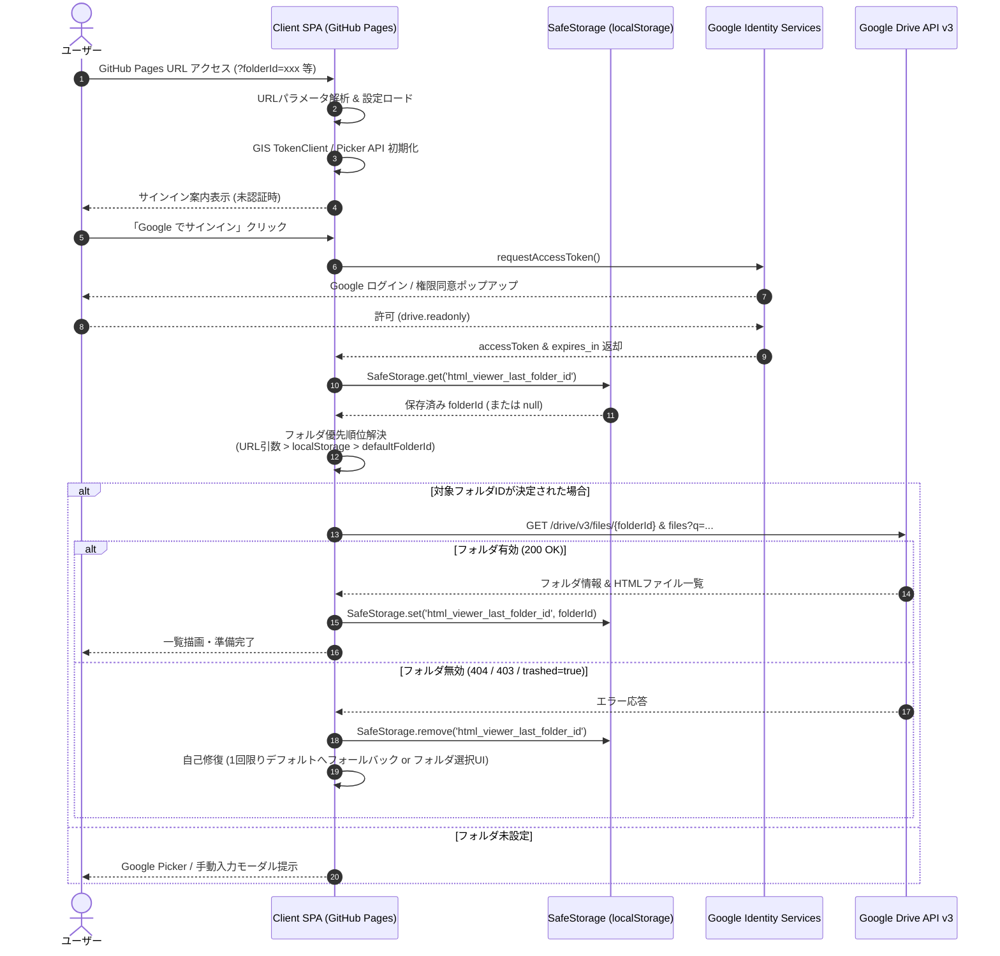
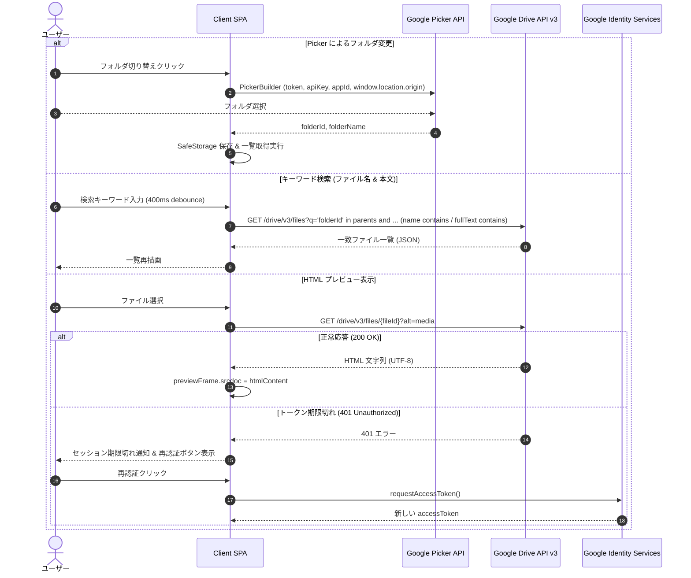

# システムアーキテクチャ設計書（GitHub Pages 移行・GAS バックエンド廃止案）

> **文書ステータス**: Phase 1（要件定義・アーキテクチャ設計）ドラフト — ユーザー確認・承認待ち  
> **対象リポジトリ**: `HttpViewer-app` (`https://github.com/nankojin-ops/HttpViewer-app`)  
> **関連文書**: 現行設計書 [ARCHITECTURE.md](file:///c:/Users/nanko/Downloads/HttpViewer-app/docs/architecture/ARCHITECTURE.md)

---

## 1. 要件定義サマリー

本設計書は、現行の Google Apps Script（GAS）ベース Web アプリケーション（`コード.js` + `index.html`）について、フロントエンドを GitHub Pages へ移行し、さらにバックエンドとしての GAS を廃止可能か検証した上で、新構成の要件およびシステムアーキテクチャを定義する。

### 機能要件 (Functional Requirements)

#### 移行後も維持する現行機能
- **FR-1: フォルダ選択（Google Picker & 手動入力モーダル）**
  - ユーザーが Google Picker ダイアログから Google ドライブのフォルダを選択できること。
  - Picker が利用できない環境や直接指定したい場合のために、手動入力モーダルからフォルダ ID または Google ドライブ URL（`folders/<ID>` 形式、`?id=<ID>` 形式）を入力・検証してフォルダを切り替えられること。
- **FR-2: 指定フォルダ内の HTML ファイル一覧取得**
  - 選択されたフォルダ直下のファイルから、HTML ファイル（MIME タイプが `text/html`、または拡張子が `.html` / `.htm` で、ゴミ箱に入っていないファイル）を取得し、更新日時の降順で一覧表示すること。
  - ファイル名・ファイルサイズ・更新日時を表示すること。
- **FR-3: ファイル名および本文全文検索**
  - 検索キーワード入力時（デバウンス制御付き）に、対象フォルダ直下の HTML ファイルを対象として「ファイル名」または「本文テキスト（`fullText`）」の部分一致検索を実行し、結果一覧を更新日時降順で表示すること。
  - 検索クリア操作により全件一覧へ復帰できること。
- **FR-4: HTML プレビュー表示**
  - 一覧から選択した HTML ファイルのコンテンツを UTF-8 テキストとして取得し、右ペイン（モバイル時はプレビュー画面）のサンドボックス化 `<iframe>`（`srcdoc`）内に安全に描画できること。
  - プレビューの再読込操作を行えること。
- **FR-5: URL クエリパラメータによるディープリンク**
  - アクセス URL に `?folderId=<ID>` または `?f=<ID>` が指定された場合、保存済みフォルダ設定に優先して指定フォルダを初期表示すること。
- **FR-6: 前回フォルダの永続化と自己修復・自動フォールバック**
  - 選択・検証されたフォルダ ID を永続化し、次回アクセス時に自動復元すること。
  - 復元先フォルダが削除・ゴミ箱移動・権限喪失等によりアクセス不能な場合は、無効な保存情報を自動消去し、デフォルトフォルダ（設定時）への 1 回限りのフォールバック、またはフォルダ選択 UI の提示へ安全に遷移すること。
- **FR-7: レスポンシブ 2 ペイン UI**
  - PC 画面では左ペイン（検索・一覧）と右ペイン（プレビュー）の 2 ペイン表示、モバイル画面（幅 768px 未満）では一覧画面とプレビュー画面の排他切り替え表示を維持すること。

#### GitHub Pages 移行（GAS 廃止）に伴い追加される機能要件
- **FR-8: ブラウザ上の Google OAuth 2.0 認証・再認証**
  - ユーザーがブラウザ上で Google アカウントによるサインイン（Google ドライブ読み取り権限の同意）を行い、API 呼び出し用のアクセストークンを取得できること。
  - サインアウト（トークン破棄）およびアクセストークン期限切れ（`401 Unauthorized`）時の再認証導線を提供すること。
- **FR-9: クライアントサイド設定解決**
  - GAS の `ScriptProperties` で管理していた設定値（Google Cloud OAuth Client ID、API Key、Project Number/App ID、デフォルトフォルダ ID）を、バックエンドレス構成に対応した方式（設定ファイルまたは UI 設定入力等 ※要ユーザー確認）で参照・解決できること。

#### 現行機能と新構成（案B: 完全サーバーレス）の実現性マッピング

| 現行機能 | 現行の実現手段 (`コード.js` / `index.html`) | 案B（GAS廃止）での実現手段 | 維持可否 |
| :--- | :--- | :--- | :---: |
| 認証・トークン取得 | GAS 実行権限 + `ScriptApp.getOAuthToken()` | Google Identity Services (GIS) Token Client (`drive.readonly` スコープ) | 可（要ログインUI） |
| フォルダ選択（Picker） | `gapi.load('picker')` + `google.script.host.origin` | `gapi.load('picker')` + `window.location.origin` + GIS トークン | 可（iframe制約解消） |
| フォルダ手動入力検証 | `google.script.run.getFolderDetails()` (`DriveApp`) | Drive API v3 `files.get` (`fields=id,name,mimeType,trashed`) | 可 |
| HTML ファイル一覧取得 | `google.script.run.getHtmlFileList()` (`DriveApp`) | Drive API v3 `files.list` (`q`, `orderBy=modifiedTime desc`, `nextPageToken`) | 可（ページング改善可） |
| ファイル名＆本文検索 | `google.script.run.searchHtmlFiles()` (`DriveApp.searchFiles`) | Drive API v3 `files.list` (`name contains ... or fullText contains ...`) | 可 |
| HTML プレビュー | `google.script.run.getHtmlFileContent()` → `iframe.srcdoc` | Drive API v3 `files.get?alt=media` → `iframe.srcdoc` | 可 |
| `?folderId=` / `?f=` | `doGet(e)` の `<?= urlFolderId ?>` + `window.location.search` | `window.location.search` (`URLSearchParams`) に一本化 | 可（より単純化） |
| 前回フォルダ復元・自己修復 | `UserProperties` + `SafeStorage` (`localStorage`) | ファーストパーティ `SafeStorage` (`localStorage`) ※同期範囲に差異あり | 可（制約事項参照） |
| PC/モバイル 2ペイン UI | `index.html` (Tailwind CSS + 画面幅切替 JS) | 現行 UI をそのまま継承 + 認証/トークン状態UIを追加 | 可 |

---

### 非機能要件 (Non-Functional Requirements)

- **NFR-1: 完全静的ホスティング（ゼロバックエンド維持コスト）**
  - アプリケーション本体は HTML / CSS / JavaScript の静的アセットのみで構成し、GitHub Pages 上でそのまま配信可能であること。サーバーサイドランタイム（GAS、Node.js サーバー等）を不要とすること。
- **NFR-2: 認証・アクセス制御の安全性（ゼロトラスト）**
  - GitHub Pages 公開後、リポジトリや静的ファイル自体は公開されても、Google ドライブのデータへのアクセスは閲覧者自身の Google OAuth 2.0 認証トークンに限定され、他者やリポジトリ所有者のドライブデータが露出しないこと。
  - 静的ファイル内に OAuth `client_secret` 等の機密鍵を一切含めないこと。
- **NFR-3: ファーストパーティ・ストレージの信頼性と例外遮断**
  - GAS のサンドボックス iframe（`script.googleusercontent.com`）から脱却し、GitHub Pages のトップレベルオリジンで稼働することで、サードパーティ Cookie / ストレージパーティショニング（CHIPS / ITP / ETP）による `localStorage` 消失を回避すること。
  - シークレットモード等でのアクセス例外に備え、`SafeStorage` による `try-catch` 例外遮断は継続すること。
- **NFR-4: 応答性能と非ブロッキング UX**
  - GAS のコールドスタート遅延や 1 実行あたりの制限を排除し、ブラウザから Google Drive API v3 への直接通信によって一覧取得・検索・プレビューを低遅延で実行すること。
  - 検索入力のデバウンス（400ms）および非同期リクエストのレースコンディション防止（リクエスト ID 管理）を維持すること。
- **NFR-5: トークン期限切れに対する耐障害性**
  - OAuth 2.0 アクセストークンの有効期限（通常約 1 時間）切れを検知した際、アプリのクラッシュや無言の失敗を防ぎ、ユーザーに明確な再認証操作を促し、再認証後に作業を継続できること。
- **NFR-6: 保守性・既存規約の尊重**
  - 現行のシンプルな構成と明確なコンポーネント境界を維持し、既存の Node.js ベーステスト構成（`tests/`）で純粋ロジック（URL 解析、フォルダ ID サニタイズ、カスケード解決、クエリ構築等）を継続検証できる設計とすること。

---

### 前提条件と制約事項

#### 事実（現行リポジトリ調査結果）
- 現行アプリは `コード.js`（GAS バックエンド）、`index.html`（HTML テンプレート + Vanilla JS + Tailwind CSS CDN）、`appsscript.json`、`tests/` で構成されている。
- 現行の `appsscript.json` は `webapp.executeAs: "USER_DEPLOYING"`, `webapp.access: "MYSELF"`, `oauthScopes: ["https://www.googleapis.com/auth/drive.readonly", "https://www.googleapis.com/auth/script.external_request"]` である。
- 現行 `コード.js` は `ScriptProperties` から `PICKER_API_KEY`、`PROJECT_NUMBER`、`FOLDER_ID` を、`UserProperties` から `LAST_FOLDER_ID` を参照している（リポジトリ内に実値はなく、`DEFAULT_FOLDER_ID = ''`）。
- 現行 `index.html` のプレビュー描画は `<iframe id="previewFrame" sandbox="allow-scripts allow-forms allow-same-origin">` への `srcdoc` 代入方式である。

#### 前提条件
- 利用者は有効な Google アカウントを保有し、対象フォルダへの閲覧権限（共有権限または所有権）を有していること。
- 開発者（または利用者）が Google Cloud Console 上でプロジェクトを作成し、**Google Drive API** および **Google Picker API** を有効化できること。
- Google Cloud Console の「OAuth 2.0 クライアント ID（ウェブアプリケーション）」において、**承認済み JavaScript 生成元（Authorized JavaScript origins）** に GitHub Pages のオリジン（例: `https://<username>.github.io`）およびローカルテスト用オリジン（例: `http://localhost:<port>`）を登録できること。

#### 技術的制約事項
1. **アクセストークンの有効期限**:
   - GIS Token Client（ブラウザ OAuth 2.0 トークンモデル）が発行するアクセストークンはリフレッシュトークンを伴わず、有効期限は原則 **約 3,600 秒（1 時間）** である。長時間利用時は再取得が必要となる。
2. **クロスデバイス同期の仕様変更**:
   - GAS の `PropertiesService.getUserProperties()` を廃止し `localStorage` のみで永続化する場合、**同一端末・同一ブラウザ内**では確実に復元されるが、**PC とスマートフォン間などのクロスデバイス同期**は行われない（別途同期が必要な場合は ADR-4 の拡張検討対象）。
3. **OAuth 同意画面の公開ステータスによる利用制限**:
   - Google Cloud Console の OAuth 同意画面を「テスト（Testing）」ステータスのまま運用する場合、事前に登録されたテストユーザー（最大 100 名）のみがサインイン可能となる。不特定多数へ公開する場合は Google の OAuth アプリ検証（`drive.readonly` は制限付き/機密スコープ審査対象となり得る）が必要になる点に留意すること。
4. **Drive API v3 の検索クエリ仕様**:
   - GAS `DriveApp.searchFiles` ではファイル名フィールドが `title` だったが、Google Drive API v3 の `files.list` パラメータ `q` では `name` を使用する。また `fullText contains` による本文検索は Google ドライブ側のインデックス生成に依存する。

---

### 不明点・ブロッキング事項（ユーザー確認事項）

設計を確定し Phase 2（テックリードによる実装計画）へ進む前に、以下の 4 点について意思決定が必要です。特に **B-1** は設定アーキテクチャおよびセキュリティ設計に直結する**ブロッキング事項**です。

| ID | 種別 | 確認事項・判断ポイント | 選択肢と影響 |
| :---: | :---: | :--- | :--- |
| **B-1** | **ブロッキング** | **Google Cloud 設定値（OAuth Client ID / API Key / Project Number / Default Folder ID）の保持・入力方式** | **案1（設定ファイル方式）**: リポジトリ内の JS 設定ファイルに記述（`client_id` やリファラー制限付き `apiKey` は公開前提の識別子だが、特定プロジェクト値や `defaultFolderId` がリポジトリに残る）。<br>**案2（UI 設定モーダル方式）**: アプリ内の設定画面からユーザーが入力し `localStorage` に保存（リポジトリに固有値を一切含めない汎用アプリ化。ただし初回設定の手間あり）。<br>**案3（ハイブリッド方式）**: 設定ファイルに初期値を置ける構造にしつつ、未設定時や変更時は UI 設定モーダル / URL で上書き可能にする。 |
| **B-2** | 要判断 | **旧 GAS 関連ファイル（`コード.js`, `appsscript.json`, `.claspignore`, `.clasp.json` 等）の扱い** | **案1（完全削除）**: GAS バックエンドを廃止し、GitHub Pages 静的 SPA 構成へクリーンに移行する。<br>**案2（アーカイブ残置）**: `legacy-gas/` 等へ退避、または当面残置する。 |
| **B-3** | 要確認 | **クロスデバイス間での「前回開いたフォルダ」同期の要否** | **案1（`localStorage` のみ・最小権限維持）**: `drive.readonly` スコープのみで完結。同一ブラウザ内では永続化されるが、PC とスマホ間での前回フォルダ同期は行われない（URL 共有 `?folderId=` で代替）。<br>**案2（Drive AppData 同期追加）**: `https://www.googleapis.com/auth/drive.appdata` スコープを追加し、Google ドライブのアプリ専用隠し領域に設定 JSON を保存して端末間同期を維持する。 |
| **B-4** | 要確認 | **GitHub Pages 公開構成と利用対象範囲（OAuth 同意画面ステータス）** | 1. 公開元ブランチ・ディレクトリ（例: `master` ブランチのルート `/` か `/docs` か）。<br>2. 利用対象は「ご自身・限定メンバーのみ（GCP OAuth 同意画面: テストモード）」か、「不特定多数へ公開（本番公開・Google 審査対象）」か。 |

---

## 2. システム境界とコンポーネント構成

### システム境界図（推奨構成：案B・完全サーバーレス SPA）

```
+---------------------------------------------------------------------------------------+
| 静的ホスティング: GitHub Pages (https://<user>.github.io/HttpViewer-app/)             |
| (HTML / JS / CSS のみ配信 — サーバーサイド実行・Secrets 保持なし)                     |
+-------------------------------------------|-------------------------------------------+
                                            | HTTPS 配信 (トップレベル / ファーストパーティオリジン)
                                            v
+---------------------------------------------------------------------------------------+
| ブラウザ環境 (Client SPA - 単一オリジン稼働)                                          |
|                                                                                       |
|  +-----------------------+     +------------------------+     +--------------------+  |
|  | UI / Presentation     | <-> | AppStateController     | <-> | FolderResolver     |  |
|  | (2ペイン, 認証UI,     |     | (状態遷移, 検索制御,   |     | (URL > Local > Def)|  |
|  |  モーダル, トースト)  |     |  401/エラー自己修復)   |     +--------------------+  |
|  +-----------------------+     +------------------------+               |             |
|                                  |          |          |                v             |
|          +-----------------------+          |          +--------+  +---------------+  |
|          v                                  v                   |  | URLParamParser|  |
|  +------------------+            +--------------------+         |  +---------------+  |
|  | AuthService      |            | DriveApiClient     |         v                     |
|  | (GIS TokenClient)|            | (Drive API v3 REST)|  +------------------------+   |
|  +------------------+            +--------------------+  | SafeStorage Adapter    |   |
|          |                                  |            | (1st-party localStorage|   |
|          v                                  |            +------------------------+   |
|  +------------------+                       |                                         |
|  | PickerService    |                       |                                         |
|  | (gapi.picker)    |                       |                                         |
|  +------------------+                       |                                         |
+----------|----------------------------------|-----------------------------------------+
           |                                  |
           | OAuth 2.0 Token / Picker UI      | REST fetch (HTTPS + CORS)
           |                                  | Authorization: Bearer <accessToken>
           v                                  v
+---------------------------------------------------------------------------------------+
| Google Cloud / Google APIs (外部マネージド基盤)                                       |
|  - Google Identity Services (accounts.google.com/gsi/client): 認証 & Token 発行       |
|  - Google Picker API (apis.google.com/js/api.js): フォルダ選択 UI                     |
|  - Google Drive API v3 (www.googleapis.com/drive/v3/files): フォルダ/ファイル取得・検索|
+---------------------------------------------------------------------------------------+
```

### 各コンポーネントの責務

1. **`AuthService`（認証・トークン管理）**
   - Google Identity Services (GIS) の `TokenClient` を初期化し、ユーザーのサインイン操作に応じて `drive.readonly` スコープのアクセストークンを取得する。
   - アクセストークンおよび推定有効期限（`expires_in`）をメモリ上に保持し、サインイン状態（未認証 / 認証済み / 期限切れ）を通知する。
   - ユーザー操作によるサインアウト（`google.accounts.oauth2.revoke`）およびトークン失効時の再認証フローを制御する。
2. **`AppConfigProvider`（クライアント設定管理）**
   - 動作に必要な GCP 設定（`clientId`, `apiKey`, `appId`, `defaultFolderId`）を提供する（確定方式は B-1 の判断に依存）。
3. **`DriveApiClient`（Google Drive API v3 通信アダプター）**
   - 既存の GAS サーバー関数（`getFolderDetails`, `getHtmlFileList`, `searchHtmlFiles`, `getHtmlFileContent`）を完全に置き換える REST クライアント。
   - `Authorization: Bearer <token>` ヘッダを付与して Drive API v3 へ直接 `fetch` を実行し、現行と互換の正規化レスポンス（`{ success, data, folder, error }` 相当）および HTTP ステータス分類（`401` 認証切れ、`403`/`404` アクセス不可等）を返す。
   - フォルダ ID の抽出・バリデーション（`sanitizeFolderId`）および Drive 検索クエリ文字列のエスケープ（`sanitizeSearchQuery`）を内包する。
4. **`PickerService`（Google Picker アダプター）**
   - `gapi.load('picker')` の読み込み管理とフォルダ選択ダイアログの構築を行う。
   - ファーストパーティ環境向けに `window.location.origin` を設定し、GIS で取得したトークンを `setOAuthToken` に渡す。
5. **`SafeStorageAdapter`（ファーストパーティストレージ保護）**
   - 既存の `SafeStorage` を継承し、`window.localStorage` への読み書き・削除を `try-catch` で保護する。
6. **`URLParamParser` & `FolderResolver`（初期フォルダ解決）**
   - `window.location.search` から `?folderId=` / `?f=` を抽出し、`URL > localStorage > defaultFolderId > NONE` の優先順位で初期フォルダを決定する。
7. **`AppStateController`（状態調停・自己修復制御）**
   - 認証完了を契機に初期フォルダ解決・ファイル一覧取得を開始する。
   - デバウンス付き検索、非同期リクエスト競合抑止（リクエスト ID 比較）、`401` トークン切れ時の再認証誘導、無効フォルダ検出時の自己修復（`SafeStorage.remove` + 1 回限りのデフォルトフォールバック）を統括する。
8. **`UI / Presentation`（画面描画・イベント制御）**
   - 既存の 2 ペイン（PC）/ 排他切替（モバイル）UI、`<iframe sandbox>` プレビュー、検索バー、手動入力モーダル、トースト通知を維持しつつ、未サインイン時・トークン期限切れ時の案内オーバーレイ／ヘッダー操作ボタンを提供する。

### 外部依存関係

- **GitHub Pages**: 静的ファイルの HTTPS ホスティング基盤。
- **Google Identity Services (GIS)**: `https://accounts.google.com/gsi/client` — ブラウザ OAuth 2.0 アクセストークン取得・失効。
- **Google API Loader / Google Picker API**: `https://apis.google.com/js/api.js` — フォルダ選択 UI。
- **Google Drive API v3**: `https://www.googleapis.com/drive/v3` — フォルダメタデータ取得、HTML ファイル一覧・検索、ファイル本体ダウンロード（CORS 対応済み）。
- **Tailwind CSS (CDN)**: `https://cdn.tailwindcss.com` — 現行と同一の UI スタイリング基盤。

---

## 3. データフローとインターフェース

### 3.1 アプリケーション起動・OAuth 2.0 認証・初期フォルダ復元フロー



### 3.2 フォルダ選択・検索・HTML プレビュー・トークン失効リカバリーフロー



### 3.3 主要インターフェース定義（概念仕様）

※以下はアーキテクチャ境界を示すためのインターフェース例であり、実装詳細（ファイル分割や内部実装）を拘束するものではない。

```typescript
/** クライアント設定（GCP 連携情報および既定値） */
interface AppConfig {
  clientId: string;
  apiKey: string;
  appId: string;           // Google Cloud プロジェクト番号
  defaultFolderId: string; // 任意
}

/** 認証状態とトークン管理インターフェース */
interface AuthState {
  isAuthenticated: boolean;
  accessToken: string | null;
  expiresAt: number | null; // Unix timestamp (ms)
}

interface AuthService {
  init(clientId: string, onAuthChange: (state: AuthState) => void): void;
  signIn(prompt?: '' | 'consent' | 'select_account'): void;
  signOut(): void;
  getValidToken(): string | null;
}

/** Google Drive API v3 連携結果の統一レスポンス形式 */
interface FolderInfo {
  id: string;
  name: string;
}

interface HtmlFileMetadata {
  id: string;
  name: string;
  size: number;
  updated: string; // 表示用フォーマット済み日時
}

interface DriveResult<T> {
  success: boolean;
  data?: T;
  folder?: FolderInfo;
  error?: string;
  errorCode?: 'UNAUTHORIZED' | 'NOT_FOUND' | 'FORBIDDEN' | 'TRASHED' | 'INVALID_INPUT' | 'NETWORK_ERROR';
}

interface DriveApiClient {
  getFolderDetails(folderIdOrUrl: string): Promise<DriveResult<FolderInfo>>;
  getHtmlFileList(folderId: string): Promise<DriveResult<HtmlFileMetadata[]>>;
  searchHtmlFiles(keyword: string, folderId: string): Promise<DriveResult<HtmlFileMetadata[]>>;
  getHtmlFileContent(fileId: string): Promise<DriveResult<{ content: string; fileName: string }>>;
}

/** 初期フォルダ優先順位解決（GAS 廃止後の 3 層 + NONE） */
interface FolderResolutionResult {
  folderId: string;
  source: 'URL' | 'LOCAL_STORAGE' | 'DEFAULT' | 'NONE';
}
```

---

## 4. アーキテクチャ上の決定事項 (ADR)

### ADR-1: GAS バックエンドの完全廃止と GitHub Pages 静的 SPA 構成（案B）の採用

- **決定**:
  - GAS をバックエンド API として残す「分離構成（案A）」は採用せず、**GAS バックエンドを完全に廃止し、GitHub Pages 上の静的 SPA から Google API を直接利用する「完全サーバーレス構成（案B）」を採用する**。
- **理由**:
  - 現行 `コード.js` の全機能（フォルダ情報取得、HTML 一覧、ファイル名/本文検索、HTML 本文取得、Picker 用トークン供給）はすべて Google Drive API v3 と Google Identity Services (GIS) によりブラウザから直接完結できるため、サーバーサイドロジックを保持する必然性がない。
  - **案A（GAS バックエンド分離）には以下の重大な技術的障壁がある**:
    1. **CORS およびリダイレクト制約**: GAS Web App は任意の `Access-Control-Allow-Origin` ヘッダや `OPTIONS` プリフライト応答を制御できず、実行時に `script.google.com` から `script.googleusercontent.com` へ `302` リダイレクトを行う。別オリジン（GitHub Pages）からの標準的な JSON API 呼び出し（`Authorization` ヘッダや `Content-Type: application/json` を伴う `fetch`）は CORS で遮断される。
    2. **認証モデルとサードパーティ Cookie 規制の破綻**: 現行 `appsscript.json` の `"access": "MYSELF"`（または Google ログイン必須設定）のまま GitHub Pages から `fetch` すると、現代ブラウザのサードパーティ Cookie 制限により Google 認証セッションが引き継がれず、ログイン画面へのリダイレクトが CORS エラーとなって通信自体が失敗する。
    3. **`access: "ANYONE"` 変更時のセキュリティリスク**: クロスオリジン通信を通すために GAS を匿名公開（`ANYONE_ANONYMOUS`）かつ `executeAs: USER_DEPLOYING` に変更すると、URL を知る第三者が作成者の Google ドライブを閲覧可能になる深刻な情報漏洩リスクが生じる。また `ScriptApp.getOAuthToken()` を外部 API で返却することもトークン漏洩となるため容認できない。
- **検討した代替案**:
  - *代替案（案A）: GAS Web App を JSON API 化し、GitHub Pages から `fetch` する構成* — 上記の CORS・認証・セキュリティリスクに加え、GAS と GitHub Pages の二重デプロイ保守と GAS コールドスタート遅延が残るため却下。
  - *代替案（現行維持）: GAS 単体ホスティングのまま運用* — 「フロントエンドを GitHub Pages にしたい」という要望を満たせないため却下。
- **トレードオフ**:
  - **メリット**: バックエンド運用ゼロ、CORS/iframe/サードパーティ Cookie 問題からの解放、GAS 実行クォータ制限の撤廃、レスポンス高速化、利用者の OAuth 権限のみを使うゼロトラストセキュリティ。
  - **デメリット**: Google Cloud Console での OAuth クライアント ID 発行・承認済み JavaScript 生成元設定が必須になる点、および約 1 時間ごとのアクセストークン再認証が必要になる点。
- **結果・影響**:
  - バックエンドコード（`コード.js`）と GAS プロジェクト設定（`appsscript.json` 等）が不要となる（扱いは B-2 で決定）。デプロイは GitHub リポジトリへのプッシュのみで完結する。

---

### ADR-2: クライアントサイド認証方式として Google Identity Services (GIS) Token Client を採用

- **決定**:
  - ブラウザ上の Google 認証およびアクセストークン取得基盤として、Google 公式の **Google Identity Services (GIS) OAuth 2.0 Token Client**（`google.accounts.oauth2.initTokenClient`）を採用する。
- **理由**:
  - バックエンドサーバーを持たない純粋な静的 SPA（GitHub Pages）では OAuth `client_secret` を安全に保持できないため、サーバー不要のブラウザ向けトークンモデル（GIS Token Client）が Google 公式の標準解である。
  - 非推奨となった旧 `gapi.auth2` に代わる現行サポート対象ライブラリであり、Google Picker API とも公式に連携可能である。
- **検討した代替案**:
  - *代替案A: 独自バックエンド（Cloudflare Workers / GAS 等）で Authorization Code + PKCE / Refresh Token を仲介* — インフラ追加と秘密情報管理が発生し、完全静的ホスティングの利点を損なうため不採用。
  - *代替案B: 旧 `gapi.auth2`* — 廃止・非推奨ライブラリのため不採用。
- **トレードオフ**:
  - リフレッシュトークンが発行されないため、トークン有効期限（約 1 時間）経過後は `401` 検知またはタイマーに基づき再認証（ポップアップまたはサイレント取得試行）が必要となる。
- **結果・影響**:
  - スコープは現行 `appsscript.json` と同じ最小権限 `https://www.googleapis.com/auth/drive.readonly` のみを要求する設計とする。

---

### ADR-3: Google Drive 操作の Drive API v3 直接 `fetch` への移行

- **決定**:
  - 現行 `コード.js` の `DriveApp` 呼び出しをすべて **Google Drive API v3 REST エンドポイント**（`https://www.googleapis.com/drive/v3/files`）への直接 `fetch` 呼び出しに置き換える。
- **理由**:
  - Google Drive API v3 はブラウザからのクロスオリジン `fetch`（CORS および `Authorization: Bearer` ヘッダ）を公式サポートしている。
  - 一覧取得（`files.list`）、全文検索（`q` パラメータの `fullText contains`）、フォルダ検証（`files.get`）、HTML 本文取得（`files.get?alt=media`）のすべてが GAS `DriveApp` と機能パリティを持つ。
  - さらに `fields` パラメータで必要最小限のフィールド（`id, name, size, modifiedTime, mimeType, trashed`）のみを取得でき、ページネーション（`nextPageToken`）にも対応できる。
- **検討した代替案**:
  - *代替案A: `gapi.client.drive`（GAPI クライアントライブラリ）経由での呼び出し* — Discovery Document のロード通信が増える上、標準 `fetch` ベースの薄いアダプターの方が依存が少なく軽量・テスト容易であるため `fetch` 直接呼び出しを推奨する。
- **トレードオフ**:
  - クライアント側で検索クエリのエスケープ（`\` および `'`）、HTTP エラーステータス（`401` / `403` / `404`）ハンドリング、およびページネーション処理を担う必要がある。
- **結果・影響**:
  - GAS の 1 回の実行時間制限や同期的な `hasNext()` イテレーション制約から解放される。

---

### ADR-4: フォルダ永続化ストレージのファーストパーティ `localStorage` への回帰

- **決定**:
  - 前回選択フォルダ ID の永続化ストレージとして、GitHub Pages のトップレベルオリジン上で動作する **ファーストパーティ `localStorage`（`SafeStorage` ラッパー経由）** をプライマリストレージとして採用する。
- **理由**:
  - 現行設計（[ARCHITECTURE.md](file:///c:/Users/nanko/Downloads/HttpViewer-app/docs/architecture/ARCHITECTURE.md)）でサーバー側 `UserProperties` を必要としていた根本原因は、GAS Web App が `script.googleusercontent.com` のサンドボックス iframe 内で動作していたことによるストレージ制限（CHIPS / ITP / ETP）だった。
  - GitHub Pages へ移行することで、アプリはトップレベル（ファーストパーティ）オリジンで実行されるため、通常ブラウザ環境において `localStorage` が高い信頼性で永続化される。
- **検討した代替案**:
  - *代替案A: Google Drive AppData フォルダ（`drive.appdata` スコープ追加）によるクラウド同期* — クロスデバイス同期は実現できるが、OAuth スコープの拡張（書き込み権限に相当する領域の追加）と初期化・保存時の API リクエスト増加を伴う。
- **トレードオフ**:
  - `drive.readonly` の最小権限とシンプルさを維持できる一方、**異なる端末・異なるブラウザ間での前回フォルダ自動同期は行われない**（B-3 でユーザーへ要否を確認し、必要であれば `drive.appdata` 同期を拡張採用する余地を残す）。
- **結果・影響**:
  - 既存の `resolveInitialFolderId` のカスケードは `URL > LOCAL_STORAGE > DEFAULT > NONE` の 3 層へ整理され、`saveLastFolderId` / `clearLastFolderId` のバックエンド RPC が不要となる。

---

### ADR-5: URL クエリパラメータ解決のクライアント一本化

- **決定**:
  - 現行 `index.html` の GAS テンプレート記法（`<?= typeof urlFolderId !== "undefined" ? urlFolderId : "" ?>`）を廃止し、`window.location.search`（`URLSearchParams`）によるクライアント完結型の `?folderId=` / `?f=` 解析へ一本化する。
- **理由**:
  - GitHub Pages は静的 HTML をそのまま配信するため、サーバーサイドテンプレート構文は評価されずそのまま文字列として出力されてしまう。
  - トップレベルオリジンで稼働するため、GAS iframe 時代のような「親ウィンドウの URL 引数がクライアントから見えない」制約が存在しない。
- **検討した代替案**:
  - なし（静的ホスティングにおいてクライアント側でのクエリ解析は必須かつ唯一の自然な手段）。
- **トレードオフ**:
  - URL に含まれるフォルダ ID のサニタイズ（`sanitizeFolderId`）をクライアント側で確実に実行する必要がある。また、OAuth 認証ポップアップ操作中に現在の URL クエリパラメータが失われないよう、GIS ポップアップフロー（リダイレクト型ではなくページ遷移しない Token Client）を用いることでクエリパラメータが自然に保持される。
- **結果・影響**:
  - `SERVER_URL_FOLDER_ID` 注入に起因する GAS 特有の二重管理がなくなり、ディープリンク URL の共有がそのまま機能する。

---

### ADR-6: GCP 設定値（Client ID / API Key / Project Number / Default Folder ID）の外部化方針（保留・要ユーザー決定）

- **決定**:
  - 静的アプリに必要な GCP 設定値（`clientId`, `apiKey`, `appId`, `defaultFolderId`）をリポジトリ内の設定として持つか、UI 設定入力（`localStorage` 保存）とするか、ハイブリッドとするかは、**ユーザー確認（B-1）の結果をもって最終決定する**。
- **理由**:
  - `OAuth client_id` および HTTP リファラー制限をかけたブラウザ用 `apiKey` は公開クライアント識別子であり秘密鍵ではないものの、個人用リポジトリに自己の GCP プロジェクト識別子やデフォルトフォルダ ID を公開コミットしたいか否かは運用ポリシーに依存するため、アーキテクト側で独断決定してはならない。
- **検討した代替案**:
  - *代替案1: 設定ファイル（`config.js` 等）方式* — 初回アクセスですぐにサインインでき UX が最も良い。
  - *代替案2: UI 設定モーダル方式* — リポジトリを完全に設定レス・汎用テンプレートとして公開できるが、初回利用者全員に設定入力が必要になる。
  - *代替案3: ハイブリッド方式* — 設定ファイルが空なら設定モーダルを促し、設定済みなら即サインインへ進む。
- **トレードオフ**:
  - UX の簡便性（設定不要ですぐ使える）と、設定の汎用性・秘匿性（リポジトリに固有 ID を書かない）のトレードオフ。
- **結果・影響**:
  - 設計上は `AppConfigProvider` インターフェースとして抽象化し、どの方式が選ばれても後続コンポーネント（`AuthService`, `PickerService`, `FolderResolver`）に影響が波及しない境界を確保した。

---

## 5. 品質特性に関する考慮事項

### セキュリティ (Security)
- **最小権限とゼロトラスト**: 要求スコープは原則 `https://www.googleapis.com/auth/drive.readonly` のみとし、閲覧者自身の Google アカウント権限範囲内のファイルしか操作できない。
- **機密情報の非保持**: `client_secret` は使用・保持しない。アクセストークンは `localStorage` 等の永続ストレージに書き込まず、**メモリ上のみに保持**することで XSS 等による長期トークン窃取リスクを最小化する。
- **Google Cloud Console 側の防御制限**:
  - OAuth 2.0 クライアント ID の「承認済み JavaScript 生成元」を正規の GitHub Pages オリジン（および必要な開発用 `localhost`）のみに厳格制限する。
  - API キー（Google Picker 用）に「ウェブサイトの制限（HTTP リファラー）」と「API の制限（Google Picker API のみ）」を設定し、第三者サイトでの不正流用を防止する。
- **プレビュー隔離とインジェクション対策**:
  - HTML プレビュー用 `<iframe id="previewFrame" sandbox="allow-scripts allow-forms allow-same-origin">` の `sandbox` 境界を維持する。
  - 一覧表示時のファイル名エスケープ（`escapeHtml`）、フォルダ ID 形式検証（`/^[a-zA-Z0-9_-]+$/`）、検索クエリ文字エスケープ（`\`, `'`）および `encodeURIComponent` を徹底し、Drive クエリインジェクションや XSS を防止する。
  - ※補足: `sandbox="allow-scripts allow-same-origin"` はプレビュー HTML 内スクリプトが同一オリジンとして親ウィンドウや同一オリジン `localStorage` にアクセスし得る性質を持つ（現行仕様を踏襲）。本仕様ではトークンを `localStorage` に保存しないことでトークン保護に寄与する。

### スケーラビリティ & パフォーマンス (Scalability & Performance)
- **バックエンドホップの削減**: GAS のコンテナ起動オーバーヘッド（コールドスタート）が消滅し、ブラウザから Google Drive API へ最短経路で通信できる。
- **大量ファイルへの対応**: Drive API v3 の `files.list` で `pageSize` 指定および `nextPageToken` によるページ取得をサポート可能とすることで、フォルダ内ファイル数が多い場合でも取得漏れを防げる。
- **ネットワーク負荷抑制**: `fields` クエリにより必要フィールドのみ取得し、検索入力の 400ms デバウンスとリクエスト ID による古い応答の破棄を維持する。

### 信頼性 & 可用性 (Reliability & Availability)
- **トークン有効期限切れからの回復**: API 呼び出しで `401 Unauthorized` を受信した場合、エラーを握りつぶさずトークン状態を「期限切れ」へ遷移させ、再認証ボタン／プロンプトにより作業を中断せずに復帰可能とする。
- **無効フォルダの自己修復**: 削除・ゴミ箱移動・権限喪失のフォルダを復元しようとして `403` / `404` / `trashed: true` を検知した際は、保存された `localStorage` エントリを自動削除し、1 回限りのデフォルトフォールバックまたはフォルダ選択画面へ安全に誘導する。
- **Picker 障害時のフォールバック**: `gapi` ロード失敗・API キー未設定・ポップアップブロック時でも、既存の手動フォルダ ID/URL 入力モーダルへフォールバックして継続利用できる。

### 保守性 (Maintainability)
- **単一技術スタック化**: GAS（`clasp` push / デプロイバージョン管理 / `ScriptProperties` 手動設定）の運用を廃止し、GitHub 上の標準的な Web フロントエンド資産のみに統一される。
- **疎結合なモジュール境界**: 認証（`AuthService`）、Drive API 通信（`DriveApiClient`）、ストレージ（`SafeStorageAdapter`）、フォルダ解決（`FolderResolver`）の境界を明確に分離することで、Node.js 環境での単体テスト（モック `fetch` / モック `localStorage`）が現行以上に容易になる。

---

## 6. 受け入れ基準 (Acceptance Criteria)

### 正常系（移行・機能パリティ）
- [ ] **AC-1 (GitHub Pages 単体動作・GAS 非依存)**: GitHub Pages の公開 URL 上で、GAS バックエンドおよび `google.script.run` を一切呼び出すことなくアプリケーションが起動・動作すること。
- [ ] **AC-2 (OAuth 2.0 サインイン)**: 未認証状態でアクセスした際、Google サインイン導線が表示され、GIS 経由で `drive.readonly` スコープのアクセストークンを取得してアプリが利用可能になること。
- [ ] **AC-3 (フォルダ選択: Picker & 手動入力)**: Google Picker API によるフォルダ選択、および手動入力モーダルによるフォルダ ID / Drive URL 指定の両方でフォルダを切り替えられること。
- [ ] **AC-4 (HTML 一覧表示 & 本文検索)**: 選択フォルダ内の `.html` / `.htm` / `text/html` ファイル一覧が更新日時降順で表示され、キーワード入力によりファイル名および本文全文検索（`fullText`）が動作すること。
- [ ] **AC-5 (HTML プレビュー & レスポンシブ UI)**: ファイル選択時に Drive API から HTML コンテンツを取得して `iframe.srcdoc` でプレビュー描画でき、PC 2 ペイン表示とモバイル画面切替が現行通り動作すること。
- [ ] **AC-6 (URL クエリパラメータ優先)**: `?folderId=<ID>` または `?f=<ID>` を付与してアクセスした場合、サインイン完了後に保存済みフォルダより優先して指定フォルダが開かれること。
- [ ] **AC-7 (前回フォルダ復元)**: 同一ブラウザ・同一端末でページをリロードまたは再アクセスした際、`localStorage` から前回選択したフォルダが自動復元されること。

### 異常系・セキュリティ・境界条件
- [ ] **AC-8 (トークン期限切れリカバリー)**: アクセストークンの期限切れ（Drive API `401` 応答）が発生した際、アプリがクラッシュせずユーザーへ再認証を案内し、再認証後に操作を継続できること。
- [ ] **AC-9 (無効フォルダ自己修復)**: 保存されていたフォルダが削除・ゴミ箱移動・権限剥奪された状態で起動した場合、エラー通知のうえ無効な保存値を削除し、デフォルトフォルダまたはフォルダ選択 UI へ安全にフォールバックすること（無限ループしないこと）。
- [ ] **AC-10 (`localStorage` 遮断時の例外保護)**: シークレットモードやストレージ制限下で `localStorage` アクセス例外が発生しても画面が停止せず動作継続できること。
- [ ] **AC-11 (機密情報の非露出)**: 配信される静的アセットおよび `localStorage` に OAuth `client_secret` や長期リフレッシュトークンが含まれないこと。また XSS 対策（ファイル名エスケープ）および Drive クエリインジェクション対策（検索語エスケープ・フォルダ ID 検証）が機能すること。
