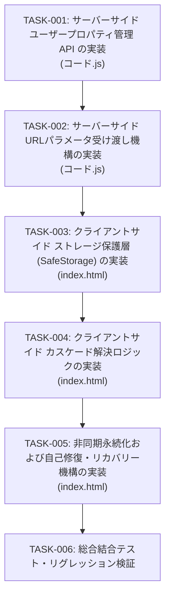

# 実装計画・タスク仕様書

## 1. アーキテクチャレビュー所見

### 1.1 実現可能性評価
`docs/architecture/ARCHITECTURE.md` に記載されたシステムアーキテクチャ設計を既存コードベース（`コード.js`, `index.html`, `appsscript.json`）と照合し、批判的・技術的に検証しました。
- **総合評価**: **承認（Feasible & Highly Sound）**
- **理由**:
  - Google Apps Script (GAS) のサンドボックス iframe（`script.googleusercontent.com`）環境において、サードパーティCookie規制やストレージパーティショニング（CHIPS）の影響を受けない `PropertiesService.getUserProperties()` をプライマリストレージとして採用する方針（ADR-1）は、課題の根本原因を完全に解消する最適解です。
  - アプリ起動時の通信オーバーヘッドについても、既存の `getAppConfig()` API の返却オブジェクトに `lastFolderId` を同梱することで、追加のラウンドトリップ（0 RTT 増加）なしで実現できます。

### 1.2 留意事項・技術リスク
実装フェーズにおいて留意・対処すべき技術的論点は以下の3点です。

1. **GAS iframe 環境における親ウィンドウ URL クエリパラメータの取得制限**:
   - サンドボックス iframe 内の JavaScript から直接 `window.location.search` を参照した場合、親ウィンドウ（`script.google.com/macros/s/.../exec?folderId=xxx`）のクエリパラメータが欠落または別ドメイン URL となる制約があります。
   - **対策**: サーバーサイドの `doGet(e)` で `e.parameter` からクエリパラメータ（`folderId` または `f`）を確実に抽出し、HTMLテンプレート経由（`<?= urlFolderId ?>`）でクライアント側のグローバル定数として注入するアーキテクチャを採用します（クライアント側の `window.location.search` もローカル環境や直接アクセス時のフォールバックとして併用）。
2. **自己修復（Self-Healing）時の無限再試行防止**:
   - 前回保存されたフォルダが無効化（削除、権限剥奪）されてデフォルトフォルダへフォールバックする際、万一デフォルトフォルダ自体も無効であった場合に無限ループ（エラー再試行の連続）に陥らないよう、状態遷移ガード（1回限りのフォールバック制御）を設けます。
3. **非同期保存（Fire-and-Forget）時の耐障害性**:
   - フォルダ変更時に `saveLastFolderId` を非同期・非ブロッキングで実行しますが、万一通信障害が発生した場合でもクライアント側の表示・操作をブロックせず、警告ログ出力に留めて Graceful に継続します。

### 1.3 アーキテクトへのエスカレーション有無
- **エスカレーション**: **なし**
- アーキテクチャ設計は堅牢であり、既存仕様との矛盾もありません。上記の留意事項を反映した詳細仕様を本実装計画にて定義します。

---

## 2. 影響範囲・変更対象ファイル一覧

### 2.1 変更対象ファイル一覧

| ファイルパス | 変更種別 | 変更概要 | 影響度 |
| :--- | :---: | :--- | :---: |
| `コード.js` | 変更 | - `doGet(e)` でのURLパラメータ抽出とテンプレートへの受け渡し<br>- `getAppConfig()` への `lastFolderId`, `urlFolderId` 追加<br>- `saveLastFolderId(folderId)` の実装<br>- `clearLastFolderId()` の実装 | 中 |
| `index.html` | 変更 | - サーバーサイドテンプレート変数の受け取り（`SERVER_CONFIG` 等）<br>- `SafeStorage`（localStorage 安全ラッパー）の実装と置換<br>- フォルダカスケード解決ロジック (`resolveInitialFolderId`) の実装<br>- `applyFolder` における非同期保存の統合<br>- フォルダ無効時の自動修復・フォールバック処理の刷新 | 中 |
| `appsscript.json` | 変更なし | `PropertiesService` は標準サービスであり、既存の OAuth スコープで動作するため変更不要。 | なし |

### 2.2 依存関係・後方互換性への考慮事項
- **後方互換性の維持**:
  - `getAppConfig()` は既存の戻り値フィールド（`token`, `apiKey`, `projectNumber`, `defaultFolderId`）をすべて保持し、追加フィールドのみを拡張します。既存の初期化フローを壊しません。
  - `getHtmlFileList`, `searchHtmlFiles`, `getHtmlFileContent` などの既存コンテンツ取得 API のシグネチャおよび内部実装は変更しません。
- **デプロイ設定との互換性**:
  - `executeAs: USER_DEPLOYING`, `access: MYSELF`（現在の設定）だけでなく、将来的に `USER_ACCESSING` や `ANYONE` へ変更された場合でも、`PropertiesService.getUserProperties()` は各 Google アカウント固有の安全な独立領域としてそのまま動作します。

---

## 3. インターフェース・データ構造仕様

### 3.1 サーバーサイド（`コード.js`）

#### 1. `doGet(e)`
```javascript
/**
 * Webアプリケーションのエントリポイント
 * @param {Object} e イベントパラメータ（e.parameter にクエリパラメータが含まれる）
 * @return {HtmlOutput}
 */
function doGet(e) {
  const template = HtmlService.createTemplateFromFile('index');
  // URLクエリパラメータから folderId または f を抽出
  const rawUrlFolderId = e && e.parameter ? (e.parameter.folderId || e.parameter.f || '') : '';
  template.urlFolderId = rawUrlFolderId ? rawUrlFolderId.trim() : '';

  return template.evaluate()
    .setTitle('HTML Viewer & Search')
    .addMetaTag('viewport', 'width=device-width, initial-scale=1.0, maximum-scale=1.0, user-scalable=no')
    .setXFrameOptionsMode(HtmlService.XFrameOptionsMode.ALLOWALL);
}
```

#### 2. `getAppConfig()`
```javascript
/**
 * フロントエンド初期化用の設定情報を返却する
 * @return {Object} {
 *   token: string,
 *   apiKey: string,
 *   projectNumber: string,
 *   defaultFolderId: string,
 *   lastFolderId: string
 * }
 */
function getAppConfig() {
  const scriptProps = PropertiesService.getScriptProperties();
  const userProps = PropertiesService.getUserProperties();

  const lastFolderId = userProps.getProperty('LAST_FOLDER_ID') || '';

  return {
    token: ScriptApp.getOAuthToken(),
    apiKey: scriptProps.getProperty('PICKER_API_KEY') || '',
    projectNumber: scriptProps.getProperty('PROJECT_NUMBER') || '',
    defaultFolderId: getDefaultFolderId_(),
    lastFolderId: lastFolderId.trim()
  };
}
```

#### 3. `saveLastFolderId(folderId)`
```javascript
/**
 * ユーザーの前回選択フォルダIDを UserProperties に保存する
 * @param {string} folderId フォルダIDまたはGoogle Drive URL
 * @return {Object} { success: boolean, savedFolderId?: string, error?: string }
 */
function saveLastFolderId(folderId) {
  try {
    const cleanId = sanitizeFolderId_(folderId);
    PropertiesService.getUserProperties().setProperty('LAST_FOLDER_ID', cleanId);
    return {
      success: true,
      savedFolderId: cleanId
    };
  } catch (error) {
    return {
      success: false,
      error: error.message
    };
  }
}
```

#### 4. `clearLastFolderId()`
```javascript
/**
 * ユーザーの前回選択フォルダIDを UserProperties から削除する（自己修復・クリア用）
 * @return {Object} { success: boolean, error?: string }
 */
function clearLastFolderId() {
  try {
    PropertiesService.getUserProperties().deleteProperty('LAST_FOLDER_ID');
    return {
      success: true
    };
  } catch (error) {
    return {
      success: false,
      error: error.message
    };
  }
}
```

---

### 3.2 クライアントサイド（`index.html`）

#### 1. サーバーサイドテンプレート値の展開
`<head>` 内または `<script>` 先頭部に注入：
```html
<script>
  // サーバーサイドテンプレートから注入された初期パラメータ
  const SERVER_URL_FOLDER_ID = '<?= typeof urlFolderId !== "undefined" ? urlFolderId : "" ?>';
</script>
```

#### 2. ストレージ保護アダプター (`SafeStorage`)
```javascript
/**
 * window.localStorage を try-catch で保護した安全なストレージアダプター
 */
const SafeStorage = {
  get: function(key) {
    try {
      if (typeof window !== 'undefined' && window.localStorage) {
        return window.localStorage.getItem(key);
      }
    } catch (e) {
      console.warn('[SafeStorage] getItem failed for key:', key, e);
    }
    return null;
  },
  set: function(key, value) {
    try {
      if (typeof window !== 'undefined' && window.localStorage) {
        window.localStorage.setItem(key, value);
        return true;
      }
    } catch (e) {
      console.warn('[SafeStorage] setItem failed for key:', key, e);
    }
    return false;
  },
  remove: function(key) {
    try {
      if (typeof window !== 'undefined' && window.localStorage) {
        window.localStorage.removeItem(key);
        return true;
      }
    } catch (e) {
      console.warn('[SafeStorage] removeItem failed for key:', key, e);
    }
    return false;
  }
};
```

#### 3. フォルダカスケード解決ロジック (`resolveInitialFolderId`)
```javascript
/**
 * フォルダIDの優先順位（URL > UserProperties > localStorage > defaultFolderId）を解決する
 * @param {Object} sources 参照可能なフォルダID群
 * @param {string|null} sources.urlParam URLクエリパラメータ由来
 * @param {string|null} sources.userProp サーバー側UserProperties由来
 * @param {string|null} sources.localStore localStorage由来
 * @param {string|null} sources.defaultProp スクリプトデフォルト由来
 * @return {Object} { folderId: string, source: 'URL' | 'USER_PROPERTIES' | 'LOCAL_STORAGE' | 'DEFAULT' | 'NONE' }
 */
function resolveInitialFolderId(sources) {
  if (sources.urlParam && sources.urlParam.trim() !== '') {
    return { folderId: sources.urlParam.trim(), source: 'URL' };
  }
  if (sources.userProp && sources.userProp.trim() !== '') {
    return { folderId: sources.userProp.trim(), source: 'USER_PROPERTIES' };
  }
  if (sources.localStore && sources.localStore.trim() !== '') {
    return { folderId: sources.localStore.trim(), source: 'LOCAL_STORAGE' };
  }
  if (sources.defaultProp && sources.defaultProp.trim() !== '') {
    return { folderId: sources.defaultProp.trim(), source: 'DEFAULT' };
  }
  return { folderId: '', source: 'NONE' };
}
```

---

## 4. テスト戦略

### 4.1 単体テスト方針
1. **サーバーサイド単体検証**:
   - `sanitizeFolderId_`: 通常ID、Google Drive URL、無効文字（記号等）に対する動作検証。
   - `saveLastFolderId`: 正常なIDの保存と戻り値構造、不正な入力時の例外捕捉と `success: false` 構造の検証。
   - `clearLastFolderId`: 削除処理の実行と `success: true` の確認。
   - `getAppConfig`: 返却オブジェクトに `lastFolderId` プロパティが含まれ、型・値が正しいことの確認。
   - `doGet`: モックイベントオブジェクト `{ parameter: { folderId: 'xyz' } }` および `{ parameter: {} }` を渡した際の評価結果検証。
2. **クライアントサイド単体検証**:
   - `SafeStorage`: 通常時の値の読み書き・削除、および `localStorage` が例外をスローするようにモックした状況下でクラッシュせず `null` / `false` を返すことの検証。
   - `resolveInitialFolderId`: 4つの情報源の組み合わせ（URL優先、UserProperties優先、localStorageフォールバック、全欠落時のNONE判定）の検証。

### 4.2 結合テスト方針
1. **フォルダ切り替えと永続化同期**:
   - フォルダ変更時、UI描画の開始と同時に `saveLastFolderId` と `SafeStorage.set` が呼び出されることの確認。
   - 非同期通信が遅延または失敗した場合でも、ファイル一覧描画とプレビュー操作が正常に継続されることの確認。
2. **起動時復元フロー**:
   - 保存済みフォルダが存在する場合、初回描画時に該当フォルダのファイル一覧が自動的にロードされることの確認。
   - URLパラメータ（`?folderId=...`）が付与されている場合、保存済みフォルダがあってもURLパラメータ指定フォルダが優先されることの確認。
3. **自己修復・フォールバック**:
   - 永続化されたフォルダIDを無効な値（存在しないIDまたはゴミ箱に入ったフォルダ）に偽装して起動した場合、エラー通知が表示され、`clearLastFolderId` と `SafeStorage.remove` が実行された上で、デフォルトフォルダへの切り替えまたは選択モーダル表示へ正常に遷移することの確認。

### 4.3 回帰テスト観点
- Google Picker 連携の動作が維持されていること（Picker 開閉、選択イベントの受信）。
- 手動フォルダ入力モーダルの動作が維持されていること（ID入力、バリデーション、適用）。
- 既存の検索機能（インクリメンタル検索、検索クリア、本文検索）が影響を受けていないこと。
- HTMLプレビュー機能（iframe表示、UTF-8読み込み、再読込ボタン、モバイル一覧切り替え）が正常に機能すること。

---

## 5. 実装タスク一覧 (順序定義)



---

### タスク [TASK-001]: サーバーサイド ユーザープロパティ管理 API の実装
- **ID**: `TASK-001`
- **目的**: ユーザー固有の前回選択フォルダIDをサーバー側（`PropertiesService.getUserProperties()`）で安全に永続化・取得・削除するバックエンド API を構築する。
- **入力**:
  - `コード.js`
  - 設計仕様（3.1 節）
- **期待される結果**:
  - `saveLastFolderId(folderId)` が追加され、サニタイズ後に `LAST_FOLDER_ID` プロパティへ保存される。
  - `clearLastFolderId()` が追加され、`LAST_FOLDER_ID` プロパティが削除される。
  - `getAppConfig()` に `lastFolderId` フィールドが追加され、保存済みフォルダIDが返却される。
- **対象ファイル**:
  - `コード.js`
- **依存関係**: なし（最優先着手）
- **受け入れ基準**:
  1. `saveLastFolderId` に有効なフォルダIDまたはDrive URLを渡すと、`{ success: true, savedFolderId: '...' }` が返り、UserProperties に保存されること。
  2. `saveLastFolderId` に無効な文字列や空値を渡すと、例外を捕捉し `{ success: false, error: '...' }` が返ること。
  3. `clearLastFolderId()` を呼ぶと、UserProperties から `LAST_FOLDER_ID` が削除され `{ success: true }` が返ること。
  4. `getAppConfig()` の返却オブジェクトに `lastFolderId: string` が含まれ、既存プロパティを損なわないこと。
- **検証方法**:
  - テスト関数（スクリプト内の一時テスト関数またはローカルGASモック実行）により、保存・取得・削除の一連の流れを呼び出し、アサーションを確認する。

---

### タスク [TASK-002]: サーバーサイド URLクエリパラメータ受け渡し機構の実装
- **ID**: `TASK-002`
- **目的**: 親ウィンドウのWeb App URLに付与されたクエリパラメータ（`?folderId=...` または `?f=...`）を `doGet(e)` で捕捉し、HTMLテンプレートを介してクライアントへ確実に安全に引き渡す。
- **入力**:
  - `コード.js`
  - 設計仕様（3.1 節）
- **期待される結果**:
  - `doGet(e)` 内で `e.parameter` の `folderId` または `f` が安全に抽出され、テンプレートプロパティ `template.urlFolderId` に代入されて評価される。
- **対象ファイル**:
  - `コード.js`
- **依存関係**: `TASK-001`
- **受け入れ基準**:
  1. `doGet({ parameter: { folderId: '1234567890abcdef' } })` を評価した際、テンプレートに渡される `urlFolderId` が `'1234567890abcdef'` となること。
  2. `doGet({ parameter: { f: 'abc_xyz' } })` を評価した際、短縮形パラメータ `f` が抽出されること。
  3. `e` が未定義または引数なしで `doGet()` が呼ばれた場合でも例外が発生せず、`urlFolderId` が空文字列となること。
- **検証方法**:
  - テスト関数で引数パターン（`folderId` 指定、`f` 指定、パラメータなし、`e` が null/undefined）を呼び出し、エラーなく `HtmlOutput` が生成されることを確認する。

---

### タスク [TASK-003]: クライアントサイド ストレージ保護層 (`SafeStorage`) の実装
- **ID**: `TASK-003`
- **目的**: サードパーティCookie規制やシークレットモード等で `window.localStorage` アクセス時に `SecurityError` や例外が発生する環境でも、Web App 全体がクラッシュしないよう保護層を構築し、既存の直接アクセス箇所を置換する。
- **入力**:
  - `index.html`
  - 設計仕様（3.2 節）
- **期待される結果**:
  - `SafeStorage` オブジェクト（`get`, `set`, `remove`）が定義される。
  - `index.html` 内の `localStorage.getItem`、`localStorage.setItem`、`localStorage.removeItem` がすべて `SafeStorage` 経由に置換される。
- **対象ファイル**:
  - `index.html`
- **依存関係**: なし（独立して着手可能）
- **受け入れ基準**:
  1. `window.localStorage` が利用可能な環境で `SafeStorage.set`, `SafeStorage.get`, `SafeStorage.remove` が正常に機能すること。
  2. `window.localStorage` の各メソッドが例外（`DOMException` 等）をスローするように設定された場合でも、処理が中断（画面ホワイトアウト）せず、それぞれ `null` または `false` を返すこと。
- **検証方法**:
  - ブラウザ開発者ツールまたはテストコードで `window.localStorage` を一時的にモック/上書きし、例外発生時でもエラーなく処理が完流することを確認する。

---

### タスク [TASK-004]: クライアントサイド カスケード解決ロジックの実装
- **ID**: `TASK-004`
- **目的**: 多層防御型フォールバックチェーン（URL引数 > UserProperties > localStorage > デフォルト）に従って起動時に開くべきフォルダIDを厳格に決定する純粋関数および初期化処理を実装する。
- **入力**:
  - `index.html`
  - 設計仕様（3.2 節）
- **期待される結果**:
  - HTMLヘッダー/スクリプト部に `SERVER_URL_FOLDER_ID` のテンプレート埋め込みが実装される。
  - URL検索パラメータ（`window.location.search`）のパーサーおよび優先順位解決関数 `resolveInitialFolderId(sources)` が実装される。
  - `initializeApp()` 内でこのカスケード解決ロジックが適用される。
- **対象ファイル**:
  - `index.html`
- **依存関係**: `TASK-002`, `TASK-003`
- **受け入れ基準**:
  1. URLパラメータが存在する場合、最優先でそのフォルダIDが選択されること。
  2. URLパラメータがなく、サーバー側 `appConfig.lastFolderId` が存在する場合、それが選択されること。
  3. URLパラメータおよびサーバー側プロパティがなく、`SafeStorage` に値がある場合、ローカル値が選択されること。
  4. いずれも存在しない場合、`appConfig.defaultFolderId` が選択されること。
  5. 全て未指定（空）の場合、`source: 'NONE'` となり、フォルダ選択モーダル/Picker が開くこと。
- **検証方法**:
  - `resolveInitialFolderId` に対する各優先順位パターンの単体テストを実施し、期待通りのIDおよび `source` が返ることを確認する。

---

### タスク [TASK-005]: 非同期永続化および自己修復・リカバリー機構の実装
- **ID**: `TASK-005`
- **目的**: フォルダ選択時の非ブロッキング永続化（サーバー側 `saveLastFolderId` とクライアント側 `SafeStorage.set` の同時実行）と、アクセス不可フォルダに遭遇した際の自己修復（消去とフォールバック）を実装する。
- **入力**:
  - `index.html`
  - 設計仕様（3.1 節, 3.2 節）
- **期待される結果**:
  - `applyFolder` 内で `SafeStorage.set` と並行して `google.script.run.saveLastFolderId` を非同期呼び出し（UIや一覧取得をブロッキングしない）。
  - 起動時またはフォルダ指定時にフォルダアクセスが失敗（存在しない、削除済み、権限なし）した場合、`SafeStorage.remove` と `google.script.run.clearLastFolderId()` を即座に実行し、デフォルトフォルダまたはフォルダ選択画面へ安全にフォールバックする。
  - リカバリー時の二重フォールバックによる無限ループ防止フラグを組み込む。
- **対象ファイル**:
  - `index.html`
- **依存関係**: `TASK-001`, `TASK-003`, `TASK-004`
- **受け入れ基準**:
  1. フォルダ切り替え時、`saveLastFolderId` の完了を待たずにファイル一覧のローディングと表示が開始されること。
  2. `saveLastFolderId` の通信が失敗した場合でも、画面上のエラーで停止せず、警告ログを出力して操作が継続されること。
  3. 存在しないフォルダIDが読み込まれた場合、`clearLastFolderId` と `SafeStorage.remove` が呼ばれ、無効な状態がサーバー・クライアント双方からクリアされること。
  4. クリア後にデフォルトフォルダへの自動切り替え、またはフォルダ選択モーダルへの案内が安全に行われ、無限ループが発生しないこと。
- **検証方法**:
  - フォルダ切り替え時のネットワークログおよびコンソールログの検証。
  - 無効なフォルダID（ダミーID）を指定して起動させ、リカバリー処理（クリアAPIの呼び出しとトースト表示・フォールバック）が正しく行われることを確認する。

---

### タスク [TASK-006]: 総合結合テスト・リグレッション検証
- **ID**: `TASK-006`
- **目的**: 全タスク完了後のアプリケーション全体について、アーキテクチャ設計書の受け入れ基準（AC-1〜AC-8）および既存機能への影響（リグレッション）を網羅的に検証する。
- **入力**:
  - 修正済み `コード.js`, `index.html`
  - `docs/architecture/ARCHITECTURE.md` (第6章 受け入れ基準)
- **期待される結果**:
  - AC-1 〜 AC-8 のすべての受け入れ基準を満たすことが確認される。
  - 構文エラー、Lintエラー、未定義参照が存在しないこと。
- **対象ファイル**:
  - `コード.js`
  - `index.html`
- **依存関係**: `TASK-001`, `TASK-002`, `TASK-003`, `TASK-004`, `TASK-005`
- **受け入れ基準**:
  1. [AC-1] フォルダ選択後、UserProperties の `LAST_FOLDER_ID` に保存されること。
  2. [AC-2] リロード後に前回フォルダが自動復元されること。
  3. [AC-3] 同一アカウントの別ブラウザ/シークレットウィンドウでも前回フォルダが引き継がれること。
  4. [AC-4] `localStorage` が遮断された環境でも、エラーなく UserProperties 経由で復元されること。
  5. [AC-5] `?folderId=...` クエリパラメータ指定時、それが最優先で表示されること。
  6. [AC-6] 無効フォルダ時にエラー通知・自動消去・フォールバックが安全に機能すること。
  7. [AC-7] `localStorage` 例外環境下でもホワイトアウトしないこと。
  8. [AC-8] 非同期保存エラー時も一覧・プレビュー表示が妨げられないこと。
  9. [リグレッション] ファイル検索、HTMLプレビュー表示、レスポンシブ切り替えが正常に動作すること。
- **検証方法**:
  - Node.js 等の環境による構文チェック・静的解析の実行。
  - 実機/テスト環境（GAS Web App）でのシナリオ動作テスト。
